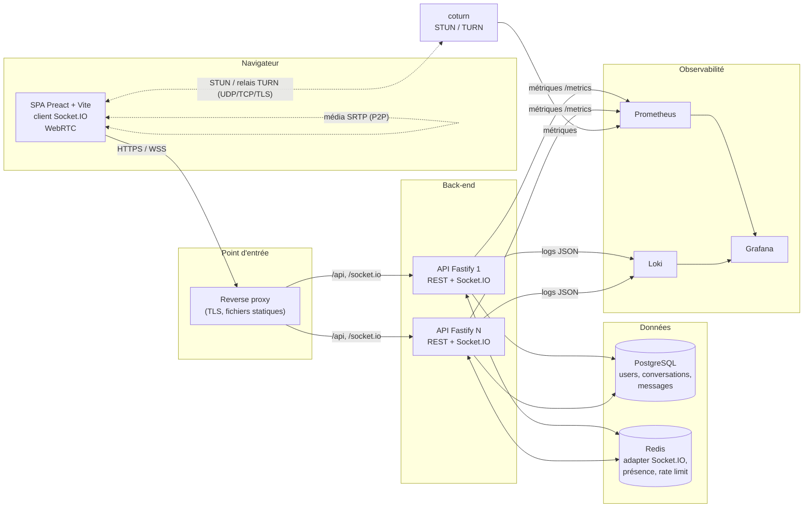
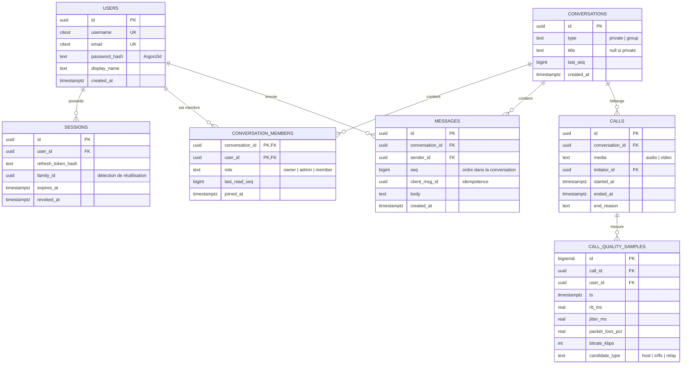
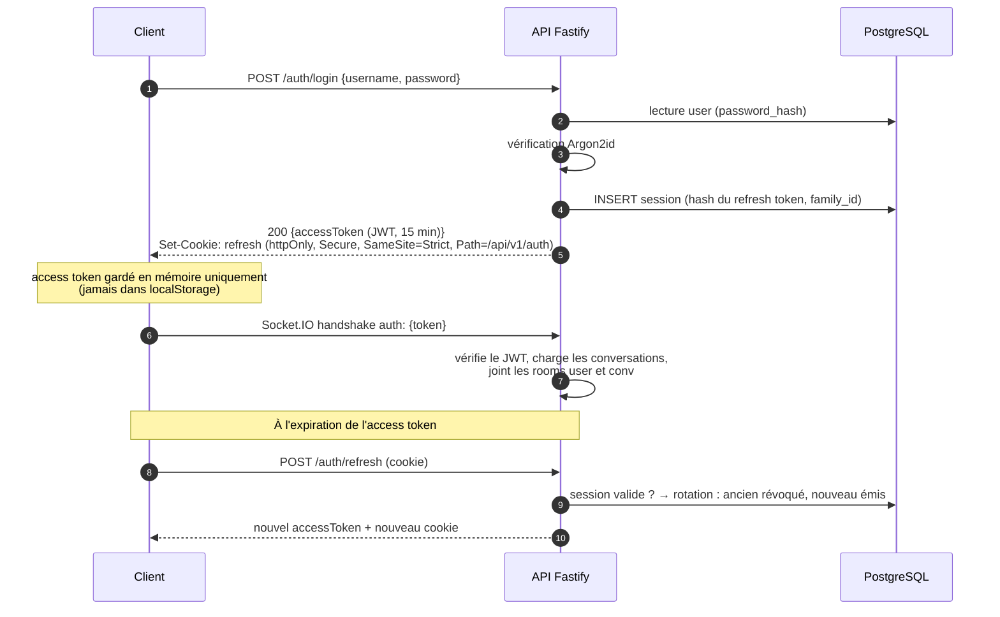
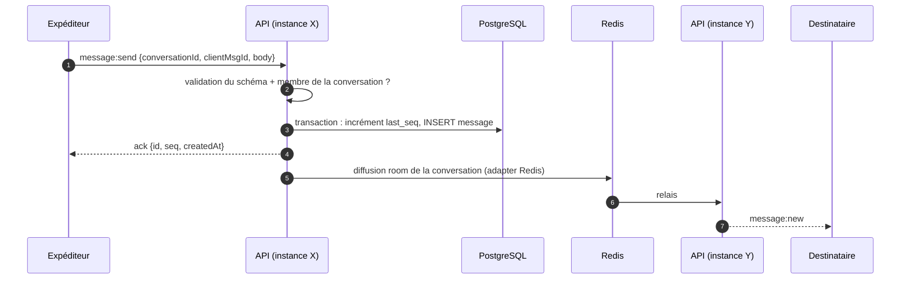
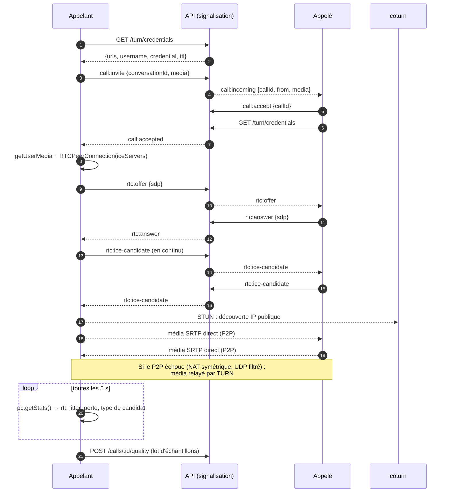
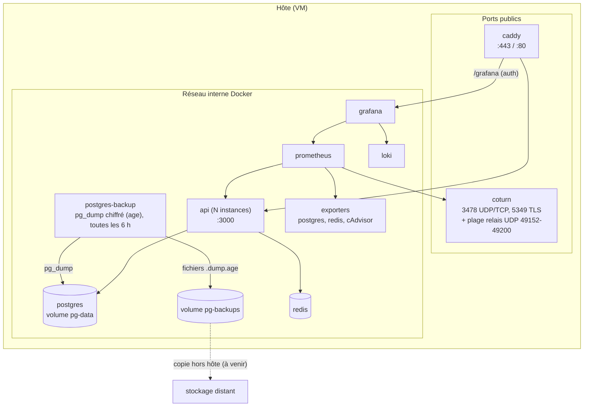

# Architecture de ChatISEN

> **Statut** : 🟠 document vivant — version initiale (phase 0, 2026-11-23).
> **Exigences couvertes** : toutes (voir la [table de traçabilité](#11-traçabilité-exigences--composants)).
>
> Ce document décrit l'architecture **cible**. Seuls deux choix sont actés par l'équipe : **Preact + Vite** côté client et **TypeScript + Fastify** côté serveur. Tout le reste est une **proposition** : chaque choix marqué _proposé_ doit faire l'objet d'un ADR dans [`docs/adr/`](adr/) avant d'être considéré comme acquis (cf. [ADR-0001](adr/0001-record-architecture-decisions.md)).

---

## 1. Vue d'ensemble

ChatISEN est une application web composée d'un **client navigateur** (SPA Preact), d'une **API Fastify** qui sert à la fois le REST et le temps réel (Socket.IO), d'une **base PostgreSQL** pour les données durables, de **Redis** pour l'état partagé entre instances, et d'un serveur **coturn** (STUN/TURN) pour que les flux voix/vidéo WebRTC traversent les NAT.

Principe structurant : **le serveur ne transporte jamais l'audio ni la vidéo.** Il gère l'identité, les messages et la *signalisation* ; les médias circulent en pair-à-pair entre navigateurs (WebRTC), relayés par TURN uniquement quand le P2P direct est impossible.



---

## 2. Composants

| Composant | Technologie | Responsabilité | Statut du choix |
| --- | --- | --- | --- |
| Client | **Preact + TypeScript + Vite** | UI, état client, client Socket.IO, WebRTC (`getUserMedia`, `RTCPeerConnection`, `getDisplayMedia`, `getStats`) | ✅ acté — ADR à écrire |
| API | **Node 22 + TypeScript + Fastify** | REST (auth, users, conversations, historique), validation des schémas, contrôle d'accès, émission de métriques | ✅ acté — ADR à écrire |
| Temps réel | **Socket.IO**, attaché au serveur HTTP de Fastify (`fastify.server`) | Livraison des messages, présence, accusés de réception, **signalisation WebRTC** | _proposé_ |
| Contrats partagés | `packages/shared` + **TypeBox** | Schémas REST et événements Socket.IO, partagés client/serveur ; TypeBox est natif dans Fastify (JSON Schema + types TS) | _proposé_ (alternative : Zod) |
| Base de données | **PostgreSQL 16** | Données durables, intégrité référentielle, historique | _proposé_ |
| Accès BDD | Drizzle ORM ou Kysely | Requêtes typées, migrations versionnées | _proposé_ |
| État partagé | **Redis 7** | Adapter Socket.IO (diffusion entre instances), présence, compteurs de rate limiting | _proposé_ |
| Traversée NAT | **coturn** | STUN (découverte d'IP publique) + TURN (relais de secours) ; identifiants éphémères | _proposé_ |
| Point d'entrée | **Caddy** (ou Nginx) | Terminaison TLS, service du build statique du client, reverse proxy vers l'API | _proposé_ |
| Métriques | **Prometheus** + `prom-client` | Collecte des métriques API, coturn, Postgres, Redis, conteneurs | _proposé_ |
| Logs | **pino** (natif Fastify) → **Loki** | Logs JSON structurés, corrélés par `requestId` | _proposé_ |
| Visualisation / alerting | **Grafana** | Dashboards, alertes | _proposé_ |
| Packaging | **Docker** (multi-stage) + **Compose** | Environnement reproductible dev et déploiement | _proposé_ |

---

## 3. Structure du dépôt

```
apps/
  web/                 SPA Preact + Vite
    src/features/      auth/, chat/, call/  (un dossier par fonctionnalité)
    src/lib/           client API, client Socket.IO, wrapper WebRTC
  api/                 Fastify + Socket.IO
    src/modules/       auth/, users/, conversations/, messages/, calls/, turn/
    src/realtime/      handlers Socket.IO, middleware d'auth du handshake
    src/plugins/       db, redis, metrics, rate-limit, security headers
    migrations/
packages/
  shared/              schémas TypeBox + types : DTO REST, événements Socket.IO, codes d'erreur
infra/
  compose/             docker-compose.yml (+ override dev)
  caddy/               Caddyfile
  coturn/              turnserver.conf
  monitoring/          prometheus.yml, règles d'alerte, dashboards Grafana (JSON), config Loki
docs/
```

Règle : **`apps/web` et `apps/api` ne dépendent jamais l'un de l'autre**, uniquement de `packages/shared`. Un changement de contrat casse la compilation des deux côtés — c'est voulu (NFR-05).

---

## 4. Modèle de données



Points de conception :

- **Ordre des messages** : `seq` est un compteur **par conversation**, attribué dans la même transaction que l'insertion (`UPDATE conversations SET last_seq = last_seq + 1 … RETURNING`). Contrainte `UNIQUE (conversation_id, seq)`. L'ordre affiché est celui du serveur, jamais l'horloge du client.
- **Idempotence** : contrainte `UNIQUE (conversation_id, client_msg_id)`. Un client qui renvoie un message après une coupure obtient le message déjà stocké, pas un doublon (FR-17, FR-18).
- **Conversation privée** : une conversation `private` a exactement deux membres ; l'unicité de la paire est garantie applicativement (ou par une colonne `private_key` = paire d'ids triée, `UNIQUE`).
- **Lu / non lu** : `last_read_seq` par membre suffit à calculer les non-lus sans table supplémentaire.
- **`CALL_QUALITY_SAMPLES`** alimente directement le travail Data / IA (latence, jitter, perte, type de candidat ICE). Si le volume devient gênant, ces échantillons peuvent être déplacés vers un stockage séparé ; à mesurer avant d'optimiser.
- Index principal : `messages (conversation_id, seq DESC)` — c'est la requête d'historique paginé.

---

## 5. Contrats d'interface

Tous les schémas sont définis **une seule fois** dans `packages/shared` et importés des deux côtés. Fastify valide chaque requête et chaque réponse contre son schéma ; les handlers Socket.IO valident chaque payload entrant.

### 5.1 REST (`/api/v1`)

| Méthode | Route | Rôle | Exigences |
| --- | --- | --- | --- |
| POST | `/auth/register` | Inscription | FR-01, FR-02 |
| POST | `/auth/login` | Connexion → access token + cookie refresh | FR-01, FR-04 |
| POST | `/auth/refresh` | Rotation du refresh token | FR-04 |
| POST | `/auth/logout` | Révocation de la session | FR-04 |
| GET | `/users/me` · PATCH `/users/me` | Profil | FR-02 |
| GET | `/users?query=` | Recherche d'utilisateurs | FR-02 |
| GET | `/conversations` | Conversations de l'utilisateur + non-lus | FR-06 |
| POST | `/conversations` | Créer une conversation privée ou de groupe | FR-06, FR-16 |
| POST · DELETE | `/conversations/:id/members[/:userId]` | Gérer les membres (rôle requis) | FR-03, FR-16 |
| GET | `/conversations/:id/messages?before=<seq>&limit=` | Historique paginé | FR-08 |
| GET | `/turn/credentials` | Identifiants TURN éphémères | FR-09, FR-10 |
| POST | `/calls/:id/quality` | Envoi groupé d'échantillons `getStats` | FR-13 |
| GET | `/health/live` · `/health/ready` | Sondes de santé (ready = PG + Redis joignables) | NFR-03, NFR-06 |
| GET | `/metrics` | Exposition Prometheus (réseau interne uniquement) | NFR-06 |

Format d'erreur unique (FR-18) : `{ "error": { "code": "CONVERSATION_FORBIDDEN", "message": "…", "requestId": "…" } }`. Les codes sont une union TypeScript dans `packages/shared`, donc le client peut afficher un message précis pour chacun.

### 5.2 Événements Socket.IO

Convention : `domaine:action`. Les événements client → serveur utilisent l'**ack** Socket.IO pour renvoyer un résultat ou une erreur.

| Sens | Événement | Payload (résumé) | Rôle |
| --- | --- | --- | --- |
| C → S | `message:send` | `{ conversationId, clientMsgId, body }` → ack `{ id, seq, createdAt }` | Envoi (FR-05) |
| S → C | `message:new` | `Message` | Diffusion aux membres (FR-05) |
| C → S | `conversation:sync` | `{ conversationId, afterSeq }` → ack `Message[]` | Rattrapage après coupure (FR-17) |
| C → S | `message:read` | `{ conversationId, seq }` | Accusé de lecture |
| S → C | `presence:update` | `{ userId, status }` | Présence |
| C ↔ S | `typing:start` / `typing:stop` | `{ conversationId }` | Indicateur de saisie |
| C → S | `call:invite` | `{ conversationId, media }` → ack `{ callId }` | Démarrer un appel (FR-09, FR-10) |
| S → C | `call:incoming` | `{ callId, from, media }` | Sonnerie |
| C → S | `call:accept` / `call:reject` / `call:hangup` | `{ callId }` | Cycle de vie de l'appel |
| C ↔ S | `rtc:offer` / `rtc:answer` | `{ callId, to, sdp }` | Signalisation SDP |
| C ↔ S | `rtc:ice-candidate` | `{ callId, to, candidate }` | Candidats ICE |
| S → C | `call:ended` | `{ callId, reason }` | Fin d'appel |

Rooms Socket.IO : `user:<userId>` (toutes les connexions d'un utilisateur, pour les notifications et la sonnerie) et `conv:<conversationId>` (diffusion des messages). Le serveur fait rejoindre les rooms `conv:*` **lui-même**, d'après la base, au handshake : le client ne choisit jamais les rooms qu'il écoute (FR-03).

---

## 6. Flux principaux

### 6.1 Authentification et session



- **Rotation avec détection de réutilisation** : si un refresh token déjà révoqué est présenté, toute la famille de sessions (`family_id`) est révoquée — signe de vol de token.
- **Socket.IO et expiration** : le JWT est vérifié au handshake ; le serveur programme une déconnexion à l'expiration (`exp`). Le client rafraîchit puis se reconnecte avec le nouveau token, ce qui réutilise le mécanisme de reconnexion (§ 6.3).

### 6.2 Envoi d'un message



L'expéditeur affiche le message **immédiatement** en état « envoi… », puis le confirme à la réception de l'ack. Sans ack après un délai, il renvoie avec le **même `clientMsgId`** : grâce à l'idempotence, aucun doublon n'est créé.

### 6.3 Reprise après coupure réseau (FR-17)

1. Socket.IO détecte la coupure et se reconnecte automatiquement (backoff exponentiel).
2. Le client conserve, pour chaque conversation ouverte, le dernier `seq` reçu.
3. À la reconnexion, il émet `conversation:sync { afterSeq }` et reçoit les messages manqués, dans l'ordre.
4. Les messages restés en « envoi… » sont renvoyés avec leur `clientMsgId` d'origine.

La fonction *connection state recovery* de Socket.IO peut accélérer les coupures très courtes, mais **la base reste la source de vérité** : le rattrapage par `seq` fonctionne même si le client retombe sur une autre instance.

### 6.4 Appel voix / vidéo 1-1



- **Identifiants TURN éphémères** : coturn en mode `use-auth-secret` ; l'API génère `username = <expiration>:<userId>` et `credential = HMAC-SHA1(secret, username)`, avec une durée de vie courte. Aucun mot de passe TURN statique n'est exposé au client.
- coturn est configuré pour écouter en **UDP 3478, TCP 3478 et TLS 443/5349** : sur un réseau d'école ou d'entreprise qui filtre l'UDP, TURN sur TLS 443 reste la dernière option qui passe (risque R4).
- **Micro / caméra** (FR-11) : activation / désactivation via `track.enabled`, sans renégociation. **Partage d'écran** (FR-15) : `getDisplayMedia()` puis `RTCRtpSender.replaceTrack()` sur la piste vidéo, sans renégociation non plus.

---

## 7. Conférences multi-participants (FR-12, extension)

Décision **ouverte** — ADR à écrire avant toute implémentation.

| Option | Principe | Pour | Contre |
| --- | --- | --- | --- |
| **Mesh** | Chaque participant ouvre une connexion vers chacun des autres | Aucune infra média, réutilise la signalisation 1-1 | n × (n − 1) flux : bande passante montante et CPU explosent au-delà de 3-4 participants |
| **SFU** (mediasoup, LiveKit, Janus) | Chaque participant envoie un flux au serveur, qui le redistribue | Passe à l'échelle, permet le simulcast | Nouveau composant critique, beaucoup plus de complexité, coût serveur |

Proposition : **mesh limité à 3-4 participants**, avec une limite **mesurée** (CPU, débit, qualité via `getStats` à 2, 3, 4 participants) et documentée. Le rapport explique ce qu'un SFU résoudrait et à partir de quel seuil il deviendrait nécessaire.

---

## 8. Déploiement

### 8.1 Topologie (Docker Compose)



- **Un seul `docker compose up`** démarre l'environnement complet ; les mêmes images servent en dev et en déploiement (NFR-07).
- coturn tourne de préférence en `network_mode: host` : le NAT de Docker sur une large plage UDP dégrade les performances et complique la configuration.
- **Postgres et Redis ne sont jamais exposés publiquement.** `/metrics` n'est accessible que depuis le réseau interne.
- **Sauvegardes** ([`infra/backup/`](../infra/backup/), issue #9) : le service `postgres-backup` fait un `pg_dump` toutes les 6 h, chiffré avec la **clé publique** age de l'équipe (la clé privée n'est jamais sur le serveur), dans le volume `pg-backups`, distinct de `pg-data`. Rétention 7 jours. RPO = 6 h. La restauration est testée automatiquement chaque semaine et à chaque changement de `infra/backup/` ; procédure et RTO mesuré dans le [runbook](report/12-monitoring-evaluation-operationnelle.md#runbook--sauvegarde-et-restauration-de-postgresql). La copie hors de l'hôte dépend du choix d'hébergement.
- **Plusieurs instances d'API** : l'adapter Redis gère la diffusion entre instances. Socket.IO exige des **sticky sessions** si le transport *long-polling* est utilisé ; deux options, à trancher par ADR : affinité dans le reverse proxy, ou transport `websocket` seul (plus simple, perd le repli HTTP).
- **Hébergement** : non défini (question 4 dans [`prof-qa.md`](prof-qa.md)). L'architecture ne suppose qu'une VM avec Docker et une IP publique (nécessaire pour TURN). Kubernetes (k3s) est une évolution possible si la scalabilité doit être démontrée au-delà de Compose — ADR « Compose vs Kubernetes ».

### 8.2 Chaîne CI/CD

```
PR  : hygiène PR → lint → typecheck → tests (Vitest) → Semgrep (SAST)        [en place : hygiène + Semgrep]
main: … → build images Docker → Trivy (scan d'image) → push registry → déploiement
```

Les images sont taguées avec le SHA du commit ; **un rollback = redéployer le tag précédent**.

---

## 9. Sécurité (vue architecture)

Le modèle de menaces détaillé (STRIDE) et les exigences `SEC-xx` sont dans le [chapitre 10 du rapport](report/10-evaluation-securite.md). Cette section ne liste que les choix structurels.

| Menace | Protection prévue | Limite assumée |
| --- | --- | --- |
| Interception réseau | TLS partout (Caddy) ; WSS ; média chiffré **DTLS-SRTP** (imposé par WebRTC) | Le relais TURN voit les métadonnées (IP, volume), pas le contenu |
| Vol de mot de passe | Argon2id ; rate limiting sur `/auth/*` (`@fastify/rate-limit`, compteurs dans Redis) | Pas de MFA dans le périmètre Core |
| Vol de session | Access token court en mémoire ; refresh token en cookie `httpOnly` avec rotation et détection de réutilisation | Un XSS peut encore utiliser le token tant que la page est ouverte |
| Accès à une conversation d'autrui (IDOR) | Vérification d'appartenance **côté serveur** sur chaque route et chaque événement ; rooms choisies par le serveur | — |
| Injection / payload malformé | Validation par schéma (TypeBox) sur tout le REST et tous les événements ; requêtes paramétrées | — |
| XSS | Échappement par défaut de Preact (aucun `dangerouslySetInnerHTML`) ; CSP stricte servie par Caddy | — |
| Abus TURN (relais ouvert) | Identifiants éphémères HMAC ; `denied-peer-ip` sur les plages privées | — |
| Données au repos | Volume Postgres sur l'hôte ; sauvegardes chiffrées par age avec une clé publique, clé privée hors du serveur (§ 8.1) | Sauvegardes sur le même hôte tant qu'aucune copie distante n'existe. **Pas de chiffrement de bout en bout des messages** : le serveur peut lire l'historique. Choix assumé (la recherche et l'historique côté serveur en dépendent), à énoncer dans le rapport |
| Chaîne d'approvisionnement | Semgrep, Dependabot (avec délai de 7 jours), règles pnpm, actions épinglées par SHA, Trivy | — |

---

## 10. Observabilité, disponibilité et scalabilité

### 10.1 Signaux collectés

| Source | Métriques clés | Usage |
| --- | --- | --- |
| API (`prom-client`) | latence HTTP par route (histogramme), taux d'erreurs, connexions Socket.IO actives, messages/s, **latence d'ack `message:send`**, durée des requêtes SQL | SLO messagerie, tests de charge |
| Clients (`getStats`) | RTT, jitter, perte de paquets, débit, type de candidat ICE | Qualité de communication, Data / IA |
| coturn (exporter Prometheus intégré) | allocations actives, octets relayés | Part des appels relayés, coût TURN |
| Postgres / Redis / conteneurs | connexions, latence, CPU, mémoire | Goulots d'étranglement |
| Logs (pino → Loki) | JSON avec `requestId`, `userId`, `socketId` | Investigation d'incident |

Alertes de départ (à calibrer après les premiers tests de charge) : taux d'erreurs 5xx, p95 de la latence d'ack au-dessus du seuil, `/health/ready` en échec, perte de paquets moyenne élevée sur les appels en cours.

### 10.2 Comportement en cas de panne (NFR-03)

| Composant indisponible | Effet | Atténuation |
| --- | --- | --- |
| Une instance d'API | Ses clients sont déconnectés | Reconnexion automatique vers une autre instance + rattrapage par `seq` |
| Redis | Plus de diffusion inter-instances ni de présence | Avec une seule instance, la messagerie continue ; l'état se reconstruit au redémarrage (Redis ne contient rien de durable) |
| PostgreSQL | Plus d'envoi ni d'historique | `/health/ready` passe en échec ; le client affiche une erreur explicite et garde les messages en file d'attente locale. Données perdues ou corrompues : restauration de la dernière sauvegarde selon le runbook (perte max 6 h) |
| coturn | Les appels entre clients derrière un NAT strict échouent ; le P2P direct fonctionne encore | Alerte dédiée ; message d'erreur explicite côté client |
| Signalisation pendant un appel | **L'appel en cours continue** (le média est P2P) ; seule une renégociation est impossible | — |

Ces scénarios servent de base aux **tests de fiabilité** (arrêt volontaire de conteneurs, dégradation réseau via `tc netem`).

### 10.3 Scalabilité (NFR-02)

- L'API est **sans état** : sessions en base, diffusion via Redis → elle se duplique horizontalement.
- Goulots prévisibles, **à vérifier par la mesure** : écritures par conversation (le compteur `last_seq` sérialise les envois dans une même conversation), nombre de connexions Socket.IO par instance, bande passante TURN.

---

## 11. Traçabilité exigences → composants

| Exigence | Composant(s) | Section |
| --- | --- | --- |
| FR-01 à FR-04 | API `auth`, table `sessions`, cookie refresh | § 6.1, § 9 |
| FR-05 à FR-08 | Socket.IO, table `messages`, historique paginé | § 5, § 6.2 |
| FR-09 à FR-11 | Signalisation Socket.IO, WebRTC, coturn | § 6.4 |
| FR-12 | Mesh ou SFU (ouvert) | § 7 |
| FR-13 | `getStats`, `call_quality_samples` | § 4, § 6.4 |
| FR-14 | Hors architecture initiale (extension non retenue à ce stade) | — |
| FR-15 | `getDisplayMedia` + `replaceTrack` | § 6.4 |
| FR-16 | `conversation_members.role` | § 4, § 5.1 |
| FR-17 | Reconnexion Socket.IO + `conversation:sync` + idempotence | § 6.3 |
| FR-18 | Format d'erreur unique, contraintes d'unicité | § 4, § 5.1 |
| NFR-01, NFR-02 | API sans état, adapter Redis, métriques | § 10 |
| NFR-03 | Sondes de santé, scénarios de panne, sauvegarde et restauration testée | § 8.1, § 10.2 |
| NFR-04 | TLS, Argon2id, JWT + rotation, contrôle d'appartenance | § 9 |
| NFR-05 | Monorepo TypeScript, `packages/shared`, schémas uniques | § 3, § 5 |
| NFR-06 | Prometheus, Loki, Grafana | § 10.1 |
| NFR-07 | Docker Compose, CI/CD, images taguées par SHA | § 8 |

---

## 12. Décisions à formaliser (ADR)

| # | Décision | Statut |
| --- | --- | --- |
| ADR-0002 | Client : Preact + Vite plutôt que React / Svelte (avec mesures de bundle) | acté, à rédiger |
| ADR-0003 | Serveur : Node + TypeScript + Fastify plutôt qu'Express / NestJS | acté, à rédiger |
| ADR-0004 | Temps réel : Socket.IO plutôt que WebSocket brut / SSE | proposé |
| ADR-0005 | Contrats partagés : TypeBox plutôt que Zod | proposé |
| ADR-0006 | Données : PostgreSQL + Redis | proposé |
| ADR-0007 | Sessions : JWT court + refresh token rotatif en cookie | proposé |
| ADR-0008 | Ordre et idempotence des messages (`seq` + `client_msg_id`) | proposé |
| ADR-0009 | Média : WebRTC P2P + coturn, identifiants éphémères | proposé |
| ADR-0010 | Conférences : mesh vs SFU | ouvert |
| ADR-0011 | Multi-instance : sticky sessions vs WebSocket seul | ouvert |
| ADR-0012 | Déploiement : Compose vs Kubernetes ; hébergement | ouvert (dépend de l'encadrant) |
| ADR-0013 | Observabilité : Prometheus + Loki + Grafana | proposé |
