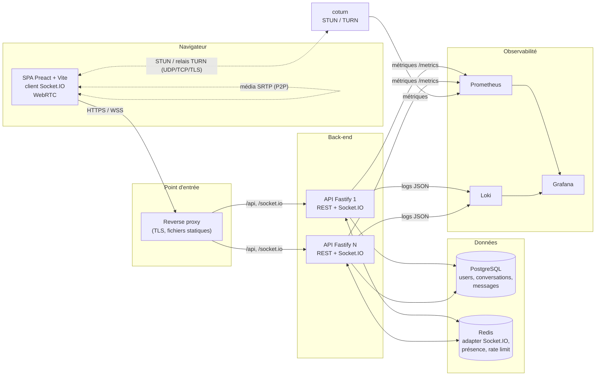
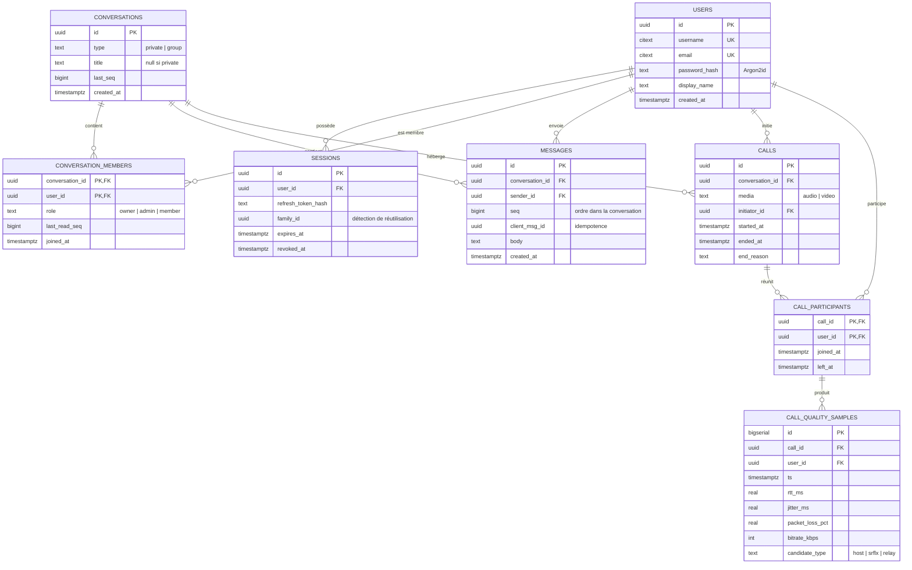
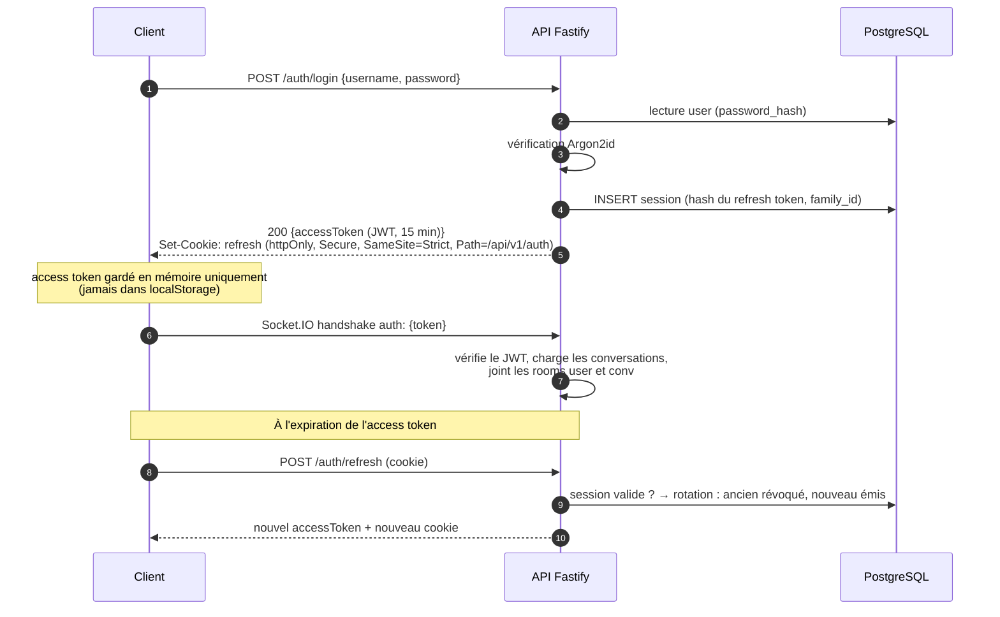
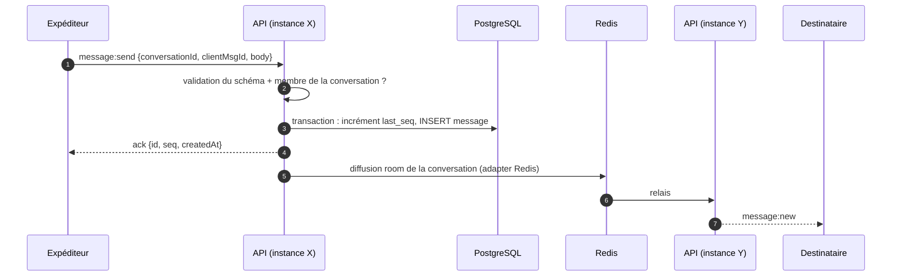
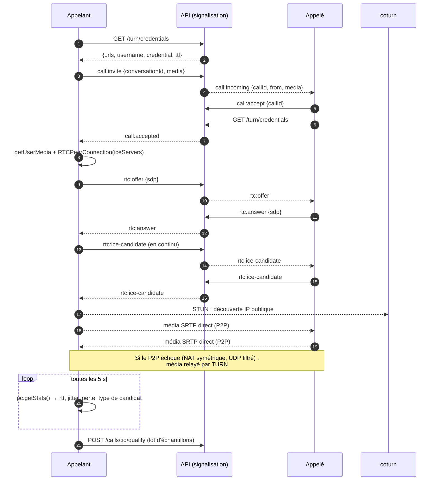
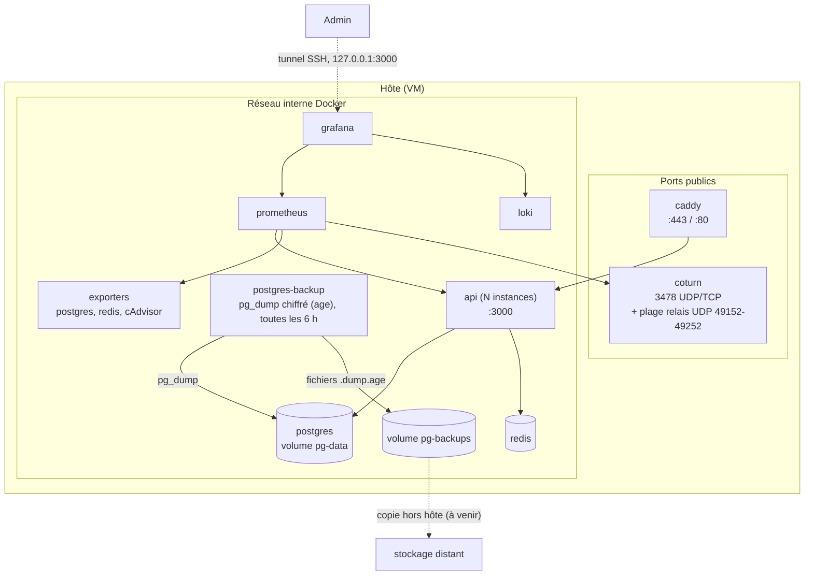
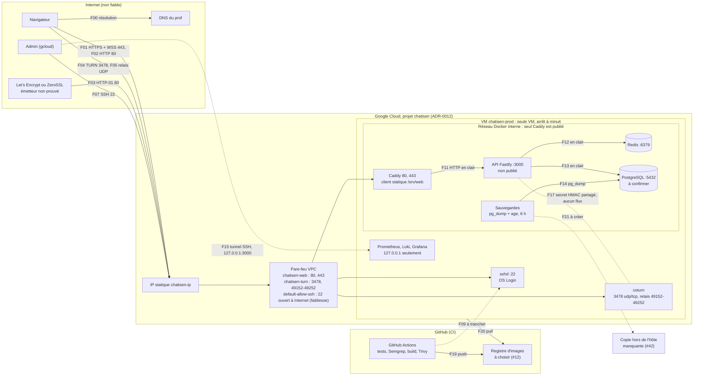
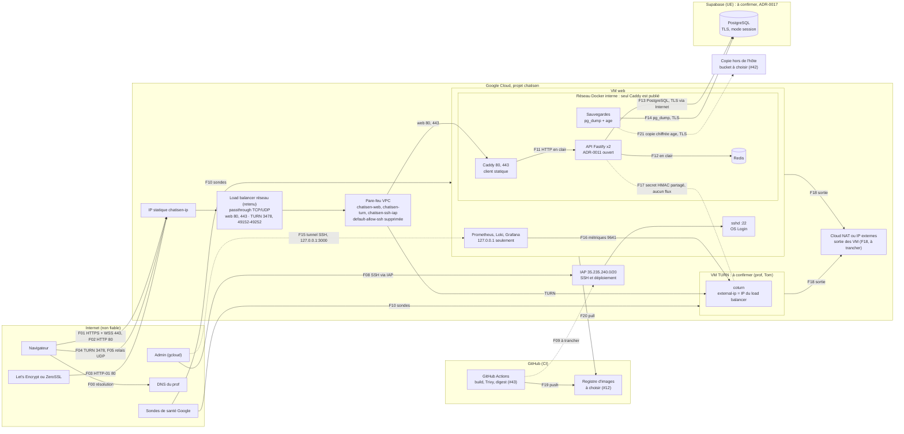

# Architecture de ChatISEN

> **Statut** : 🟠 document vivant — version initiale (phase 0, 2026-11-23).
> **Exigences couvertes** : toutes (voir la [table de traçabilité](#11-traçabilité-exigences--composants)).
>
> Ce document décrit l'architecture **cible**. Seuls deux choix sont actés par l'équipe : **Preact + Vite** côté client et **TypeScript + Fastify** côté serveur. Tout le reste est une **proposition** : chaque choix marqué _proposé_ doit faire l'objet d'un ADR dans [`docs/adr/`](adr/) avant d'être considéré comme acquis (cf. [ADR-0001](adr/0001-record-architecture-decisions.md)).

---

## 1. Vue d'ensemble

ChatISEN est une application web composée d'un **client navigateur** (SPA Preact), d'une **API Fastify** qui sert à la fois le REST et le temps réel (Socket.IO), d'une **base PostgreSQL** pour les données durables, de **Redis** pour l'état partagé entre instances, et d'un serveur **coturn** (STUN/TURN) pour que les flux voix/vidéo WebRTC traversent les NAT.

Principe structurant : **le serveur ne transporte jamais l'audio ni la vidéo.** Il gère l'identité, les messages et la *signalisation* ; les médias circulent en pair-à-pair entre navigateurs (WebRTC), relayés par TURN uniquement quand le P2P direct est impossible.



---

## 2. Composants

| Composant | Technologie | Responsabilité | Statut du choix |
| --- | --- | --- | --- |
| Client | **Preact + TypeScript + Vite** | UI, état client, client Socket.IO, WebRTC (`getUserMedia`, `RTCPeerConnection`, `getDisplayMedia`, `getStats`) | ✅ acté — ADR à écrire |
| API | **Node 22 + TypeScript + Fastify** | REST (auth, users, conversations, historique), validation des schémas, contrôle d'accès, émission de métriques | ✅ acté — ADR à écrire |
| Temps réel | **Socket.IO**, attaché au serveur HTTP de Fastify (`fastify.server`) | Livraison des messages, présence, accusés de réception, **signalisation WebRTC** | _proposé_ |
| Contrats partagés | `packages/shared` + **TypeBox** | Schémas REST et événements Socket.IO, partagés client/serveur ; TypeBox est natif dans Fastify (JSON Schema + types TS) | _proposé_ (alternative : Zod) |
| Base de données | **PostgreSQL 16** | Données durables, intégrité référentielle, historique | _proposé_ |
| Accès BDD | Drizzle ORM ou Kysely | Requêtes typées, migrations versionnées | _proposé_ |
| État partagé | **Redis 7** | Adapter Socket.IO (diffusion entre instances), présence, compteurs de rate limiting | _proposé_ |
| Traversée NAT | **coturn** | STUN (découverte d'IP publique) + TURN (relais de secours) ; identifiants éphémères | _proposé_ |
| Point d'entrée | **Caddy** (ou Nginx) | Terminaison TLS, service du build statique du client, reverse proxy vers l'API | _proposé_ |
| Métriques | **Prometheus** + `prom-client` | Collecte des métriques API, coturn, Postgres, Redis, conteneurs | _proposé_ |
| Logs | **pino** (natif Fastify) → **Loki** | Logs JSON structurés, corrélés par `requestId` | _proposé_ |
| Visualisation / alerting | **Grafana** | Dashboards, alertes | _proposé_ |
| Packaging | **Docker** (multi-stage) + **Compose** | Environnement reproductible dev et déploiement | _proposé_ |

---

## 3. Structure du dépôt

```
apps/
  web/                 SPA Preact + Vite
    src/features/      auth/, chat/, call/  (un dossier par fonctionnalité)
    src/lib/           client API, client Socket.IO, wrapper WebRTC
  api/                 Fastify + Socket.IO
    src/modules/       auth/, users/, conversations/, messages/, calls/, turn/
    src/realtime/      handlers Socket.IO, middleware d'auth du handshake
    src/plugins/       db, redis, metrics, rate-limit, security headers
    migrations/
packages/
  shared/              schémas TypeBox + types : DTO REST, événements Socket.IO, codes d'erreur
infra/
  compose/             docker-compose.yml (+ override dev)
  caddy/               Caddyfile
  coturn/              turnserver.conf
  monitoring/          prometheus.yml, règles d'alerte, dashboards Grafana (JSON), config Loki
docs/
```

Règle : **`apps/web` et `apps/api` ne dépendent jamais l'un de l'autre**, uniquement de `packages/shared`. Un changement de contrat casse la compilation des deux côtés — c'est voulu (NFR-05).

---

## 4. Modèle de données



Points de conception :

- **Ordre des messages** : `seq` est un compteur **par conversation**, attribué dans la même transaction que l'insertion (`UPDATE conversations SET last_seq = last_seq + 1 … RETURNING`). Contrainte `UNIQUE (conversation_id, seq)`. L'ordre affiché est celui du serveur, jamais l'horloge du client.
- **Idempotence** : contrainte `UNIQUE (conversation_id, client_msg_id)`. Un client qui renvoie un message après une coupure obtient le message déjà stocké, pas un doublon (FR-17, FR-18).
- **Conversation privée** : une conversation `private` a exactement deux membres ; l'unicité de la paire est garantie applicativement (ou par une colonne `private_key` = paire d'ids triée, `UNIQUE`).
- **Lu / non lu** : `last_read_seq` par membre suffit à calculer les non-lus sans table supplémentaire.
- **`CALL_PARTICIPANTS`** identifie les participants réels d'un appel ; être membre de la conversation ne suffit pas à envoyer des mesures pour cet appel. Une ligne est conservée après le départ (`left_at`) pour garder l'historique des échantillons.
- **`CALL_QUALITY_SAMPLES`** est lié à la paire (`call_id`, `user_id`) de `CALL_PARTICIPANTS` par une clé étrangère composite. L'API déduit `user_id` du JWT, n'accepte pas d'identité dans le corps, valide l'horodatage ISO-8601 envoyé avec chaque échantillon (fenêtre de 10 minutes, tolérance future de 30 secondes), borne les valeurs et limite les lots à 60 échantillons / 30 requêtes par minute / utilisateur. Cette table alimente le travail Data / IA (latence, jitter, perte, débit et type de candidat ICE). Si le volume devient gênant, ces échantillons peuvent être déplacés vers un stockage séparé ; à mesurer avant d'optimiser.
- Index principal : `messages (conversation_id, seq DESC)` — c'est la requête d'historique paginé.

---

## 5. Contrats d'interface

Tous les schémas sont définis **une seule fois** dans `packages/shared` et importés des deux côtés. Fastify valide chaque requête et chaque réponse contre son schéma ; les handlers Socket.IO valident chaque payload entrant.

### 5.1 REST (`/api/v1`)

| Méthode | Route | Rôle | Exigences |
| --- | --- | --- | --- |
| POST | `/auth/register` | Inscription | FR-01, FR-02 |
| POST | `/auth/login` | Connexion → access token + cookie refresh | FR-01, FR-04 |
| POST | `/auth/refresh` | Rotation du refresh token | FR-04 |
| POST | `/auth/logout` | Révocation de la session | FR-04 |
| GET | `/users/me` · PATCH `/users/me` | Profil | FR-02 |
| GET | `/users?query=` | Recherche d'utilisateurs | FR-02 |
| GET | `/conversations` | Conversations de l'utilisateur + non-lus | FR-06 |
| POST | `/conversations` | Créer une conversation privée ou de groupe | FR-06, FR-16 |
| POST · DELETE | `/conversations/:id/members[/:userId]` | Gérer les membres (rôle requis) | FR-03, FR-16 |
| GET | `/conversations/:id/messages?before=<seq>&limit=` | Historique paginé | FR-08 |
| GET | `/turn/credentials` | Identifiants TURN éphémères | FR-09, FR-10 |
| POST | `/calls/:id/quality` | Envoi groupé d'échantillons `getStats` par un participant actif (1 à 60 échantillons, 30 lots/minute/utilisateur) | FR-13, NFR-04 |
| GET | `/health/live` · `/health/ready` | Sondes de santé (ready = PG + Redis joignables) | NFR-03, NFR-06 |
| GET | `/metrics` | Exposition Prometheus (réseau interne uniquement) | NFR-06 |

Format d'erreur unique (FR-18) : `{ "error": { "code": "CONVERSATION_FORBIDDEN", "message": "…", "requestId": "…" } }`. Les codes sont une union TypeScript dans `packages/shared`, donc le client peut afficher un message précis pour chacun.

Correspondance entre statut HTTP et code (`apps/api/src/app.ts`, issue #60) : les erreurs métier portent leur propre code (`USERNAME_TAKEN`, `CONVERSATION_FORBIDDEN`…). Les autres erreurs prennent le code de leur statut, avec un message générique qui ne laisse passer aucun détail interne (message d'un parseur, d'un plugin) :

| Statut | Code |
| --- | --- |
| 400 (validation de schéma) | `VALIDATION_FAILED`, avec le champ fautif |
| 401 | `UNAUTHENTICATED` |
| 403 | `FORBIDDEN` |
| 404 | `NOT_FOUND` |
| 429 | `RATE_LIMITED` |
| autre 4xx | `VALIDATION_FAILED` |
| 5xx | `INTERNAL_ERROR` (détail uniquement dans les logs) |

### 5.2 Événements Socket.IO

Convention : `domaine:action`. Les événements client → serveur utilisent l'**ack** Socket.IO pour renvoyer un résultat ou une erreur.

| Sens | Événement | Payload (résumé) | Rôle |
| --- | --- | --- | --- |
| C → S | `message:send` | `{ conversationId, clientMsgId, body }` → ack `{ id, seq, createdAt }` | Envoi (FR-05) |
| S → C | `message:new` | `Message` | Diffusion aux membres (FR-05) |
| C → S | `conversation:sync` | `{ conversationId, afterSeq }` → ack `Message[]` | Rattrapage après coupure (FR-17) |
| C → S | `message:read` | `{ conversationId, seq }` | Accusé de lecture |
| S → C | `conversation:member-added` | `{ conversationId, userId, role, by }` | Un membre a été ajouté ; reçu aussi par le membre ajouté (FR-16, § 5.3) |
| S → C | `conversation:member-removed` | `{ conversationId, userId, by, reason }` | Un membre a été retiré ou a quitté ; reçu aussi par le membre retiré (FR-03, FR-16, § 5.3) |
| S → C | `presence:update` | `{ userId, status }` | Présence |
| C ↔ S | `typing:start` / `typing:stop` | `{ conversationId }` | Indicateur de saisie |
| C → S | `call:invite` | `{ conversationId, media }` → ack `{ callId }` | Démarrer un appel (FR-09, FR-10) |
| S → C | `call:incoming` | `{ callId, from, media }` | Sonnerie |
| C → S | `call:accept` / `call:reject` / `call:hangup` | `{ callId }` | Cycle de vie de l'appel |
| C ↔ S | `rtc:offer` / `rtc:answer` | `{ callId, to, sdp }` | Signalisation SDP |
| C ↔ S | `rtc:ice-candidate` | `{ callId, to, candidate }` | Candidats ICE |
| S → C | `call:ended` | `{ callId, reason }` | Fin d'appel |

Rooms Socket.IO : `user:<userId>` (toutes les connexions d'un utilisateur, pour les notifications et la sonnerie) et `conv:<conversationId>` (diffusion des messages). Le serveur fait rejoindre les rooms `conv:*` **lui-même**, d'après la base, au handshake : le client ne choisit jamais les rooms qu'il écoute (FR-03). Quand l'appartenance change pendant qu'un membre est connecté, le serveur met ses rooms à jour en direct (§ 5.3).

### 5.3 Changement d'appartenance pendant qu'un membre est connecté (FR-03, FR-16, NFR-04)

Le handshake ne suffit pas : un membre retiré d'un groupe resterait dans la room `conv:<id>` jusqu'à sa reconnexion et continuerait à recevoir `message:new`. C'est une **fuite d'accès** à une conversation privée. Règle : **l'appartenance en base est la seule source de vérité, et les rooms la suivent en direct**, sans attendre une reconnexion.

**Déclencheurs.** Toute écriture dans `conversation_members` : `POST /conversations/:id/members` (ajout), `DELETE /conversations/:id/members/:userId` (retrait par un owner/admin, ou départ volontaire quand `userId` est soi-même), création d'une conversation, suppression d'une conversation. Un changement de rôle ne touche pas aux rooms.

**Retrait d'un membre** — dans cet ordre :

1. Transaction : `DELETE FROM conversation_members …`, puis **commit**.
2. Après le commit, l'instance qui a traité la requête appelle `io.in("user:<userId>").socketsLeave("conv:<conversationId>")`. Avec l'adapter Redis, l'opération est **relayée à toutes les instances** : toutes les sockets de l'utilisateur quittent la room, quelle que soit l'instance où elles sont connectées. À partir de là, il ne reçoit plus de `message:new` pour cette conversation.
3. Émission de `conversation:member-removed` à `user:<userId>` (le client retire la conversation de sa liste et ferme la vue si elle est ouverte), puis à `conv:<conversationId>` (les membres restants mettent à jour la liste des membres).
4. Si le membre retiré est dans un appel de cette conversation, le serveur le sort de l'appel (`call:ended { reason: "removed" }`, à implémenter avec la signalisation d'appel) : la signalisation lui est refusée, même si le média P2P déjà établi ne peut être coupé que par ses pairs, qui reçoivent aussi l'événement et ferment la connexion.

**Ajout d'un membre** — même schéma, sens inverse : commit, puis `io.in("user:<userId>").socketsJoin("conv:<conversationId>")` (relayé par Redis), puis `conversation:member-added` à `user:<userId>` et à `conv:<conversationId>`. Le client ajouté affiche la conversation et charge l'historique par REST (`GET /conversations/:id/messages`) ; **aucune reconnexion n'est nécessaire**.

**Autorisation à chaque événement entrant** (défense en profondeur). Être dans une room ne donne aucun droit. Chaque événement client → serveur qui porte un `conversationId` (`message:send`, `conversation:sync`, `message:read`, `typing:*`, `call:invite`) revérifie l'appartenance en base au moment de l'émission, et renvoie `CONVERSATION_FORBIDDEN` dans l'ack sinon. Un membre retiré ne peut donc ni écrire, ni rattraper l'historique par `conversation:sync`, même si une socket était restée dans la room par erreur. Si un cache d'appartenance est ajouté pour la performance, il est invalidé dans la même étape 2 que les rooms.

**Courses et cas limites.**

- **Message envoyé pendant le retrait** : un message dont la transaction est validée avant celle du retrait peut encore être livré au membre retiré ; ceux validés après ne le sont pas. La frontière est le commit du retrait, c'est le comportement attendu.
- **Reconnexion pendant le retrait** : le handshake relit l'appartenance en base. Une socket qui se connecte après le commit ne rejoint pas la room ; une socket qui se connecte juste avant est couverte par l'étape 2.
- **Message Redis perdu** : l'adapter Redis repose sur le pub/sub, sans garantie de livraison. Si une instance manque le `socketsLeave` (coupure Redis), une socket peut rester dans la room. Garde-fous : l'autorisation à chaque événement entrant (ci-dessus), et la déconnexion à l'expiration de l'access token (15 min, § 6.1) qui force un nouveau handshake depuis la base. La fenêtre d'exposition est donc **bornée à 15 minutes** dans ce cas de panne ; elle est à signaler dans le rapport sécurité.
- **Déconnexion forcée** : quand ce n'est plus une conversation mais le compte ou la session qui perd ses droits (logout, révocation d'une famille de refresh tokens, compte désactivé), le serveur ferme les sockets concernées avec `disconnectSockets(true)`, relayé lui aussi à toutes les instances. Chaque socket rejoint au handshake une room `session:<sessionId>` : un logout ne ferme que les sockets de cette session, une révocation de famille ferme celles de toute la famille, et les autres appareils de l'utilisateur restent connectés.
- **Suppression d'une conversation** : `io.in("conv:<conversationId>").socketsLeave("conv:<conversationId>")` après le commit, puis `conversation:member-removed { reason: "deleted" }` à chaque ancien membre.

**Implémentation et tests** : `apps/api/src/realtime/events.ts` (issue #57, suite de #7), testé par `apps/api/src/realtime/live-rooms.test.ts`. Deux instances d'API derrière un même Redis, deux clients connectés sur deux instances différentes :

- retrait : B est retiré par A via REST ; B reçoit `conversation:member-removed` ; un message envoyé ensuite par A **n'arrive pas** chez B ; `message:send` et `conversation:sync` de B sont refusés ;
- ajout : C est ajouté pendant qu'il est connecté ; il reçoit `conversation:member-added` puis le message suivant envoyé dans la conversation, **sans reconnexion** ;
- les deux cas sont joués avec le client concerné sur l'instance qui **n'a pas** traité la requête REST, pour prouver le relais par l'adapter Redis.

---

## 6. Flux principaux

### 6.1 Authentification et session



- **Rotation avec détection de réutilisation** : si un refresh token déjà révoqué est présenté, toute la famille de sessions (`family_id`) est révoquée — signe de vol de token.
- **Socket.IO et expiration** : le JWT est vérifié au handshake ; le serveur programme une déconnexion à l'expiration (`exp`). Le client rafraîchit puis se reconnecte avec le nouveau token, ce qui réutilise le mécanisme de reconnexion (§ 6.3).

### 6.2 Envoi d'un message



L'expéditeur affiche le message **immédiatement** en état « envoi… », puis le confirme à la réception de l'ack. Sans ack après un délai, il renvoie avec le **même `clientMsgId`** : grâce à l'idempotence, aucun doublon n'est créé.

### 6.3 Reprise après coupure réseau (FR-17)

1. Socket.IO détecte la coupure et se reconnecte automatiquement (backoff exponentiel).
2. Le client conserve, pour chaque conversation ouverte, le dernier `seq` reçu.
3. À la reconnexion, il émet `conversation:sync { afterSeq }` et reçoit les messages manqués, dans l'ordre.
4. Les messages restés en « envoi… » sont renvoyés avec leur `clientMsgId` d'origine.

La fonction *connection state recovery* de Socket.IO peut accélérer les coupures très courtes, mais **la base reste la source de vérité** : le rattrapage par `seq` fonctionne même si le client retombe sur une autre instance.

### 6.4 Appel voix / vidéo 1-1



- **Identifiants TURN éphémères** : coturn en mode `use-auth-secret` ; l'API génère `username = <expiration>:<userId>` et `credential = HMAC-SHA1(secret, username)`, avec une durée de vie courte. Aucun mot de passe TURN statique n'est exposé au client.
- coturn écoute en **UDP 3478 et TCP 3478**, avec une plage de relais UDP **49152-49252** ([ADR-0016](adr/0016-point-d-entree-caddy-et-ports-turn.md) § 5). Il n'y a **pas de TURN sur TLS 443** : Caddy occupe ce port, et le TLS sur 5349 n'est pas retenu pour la première version (le média WebRTC reste chiffré par DTLS-SRTP, mais les messages TURN eux-mêmes ne le sont pas). Un réseau qui ne laisse passer que le 443 bloquera donc les appels relayés : c'est le risque R4, à mesurer depuis le réseau de la salle de démo.
- **Micro / caméra** (FR-11) : activation / désactivation via `track.enabled`, sans renégociation. **Partage d'écran** (FR-15) : `getDisplayMedia()` puis `RTCRtpSender.replaceTrack()` sur la piste vidéo, sans renégociation non plus.

---

## 7. Conférences multi-participants (FR-12, extension)

Décision **ouverte** — ADR à écrire avant toute implémentation.

| Option | Principe | Pour | Contre |
| --- | --- | --- | --- |
| **Mesh** | Chaque participant ouvre une connexion vers chacun des autres | Aucune infra média, réutilise la signalisation 1-1 | n × (n − 1) flux : bande passante montante et CPU explosent au-delà de 3-4 participants |
| **SFU** (mediasoup, LiveKit, Janus) | Chaque participant envoie un flux au serveur, qui le redistribue | Passe à l'échelle, permet le simulcast | Nouveau composant critique, beaucoup plus de complexité, coût serveur |

Proposition : **mesh limité à 3-4 participants**, avec une limite **mesurée** (CPU, débit, qualité via `getStats` à 2, 3, 4 participants) et documentée. Le rapport explique ce qu'un SFU résoudrait et à partir de quel seuil il deviendrait nécessaire.

---

## 8. Déploiement

### 8.1 Topologie (Docker Compose)



- **Un seul `docker compose up`** démarre l'environnement complet ; les mêmes images servent en dev et en déploiement (NFR-07).
- coturn tourne de préférence en `network_mode: host` : le NAT de Docker sur une large plage UDP dégrade les performances et complique la configuration.
- **Postgres et Redis ne sont jamais exposés publiquement.** `/metrics` n'est accessible que depuis le réseau interne. Grafana et Prometheus n'écoutent que sur `127.0.0.1` de la VM (accès par tunnel SSH). La vue cible du § 8.3 déplace PostgreSQL chez Supabase, **à confirmer** avec le prof et Tom : elle contredit cette règle et l'ADR-0006.
- **Sauvegardes** ([`infra/backup/`](../infra/backup/), issue #9) : le service `postgres-backup` fait un `pg_dump` toutes les 6 h, chiffré avec la **clé publique** age de l'équipe (la clé privée n'est jamais sur le serveur), dans le volume `pg-backups`, distinct de `pg-data`. Rétention 7 jours. RPO = 6 h. La restauration est testée automatiquement chaque semaine et à chaque changement de `infra/backup/` ; procédure et RTO mesuré dans le [runbook](report/12-monitoring-evaluation-operationnelle.md#runbook--sauvegarde-et-restauration-de-postgresql). La copie hors de l'hôte dépend du choix d'hébergement.
- **Plusieurs instances d'API** : l'adapter Redis gère la diffusion entre instances. Socket.IO exige des **sticky sessions** si le transport *long-polling* est utilisé ; deux options, à trancher par ADR : affinité dans le reverse proxy, ou transport `websocket` seul (plus simple, perd le repli HTTP).
- **Hébergement** : Google Cloud, une VM Compute Engine avec une IP statique ; point d'entrée Caddy sur un seul nom d'hôte ([ADR-0012](adr/0012-deploiement-et-hebergement.md) et [ADR-0016](adr/0016-point-d-entree-caddy-et-ports-turn.md), statut « proposé »). Kubernetes (k3s) est suspendu par le planning ; le détail des flux, des ports et des chiffrements est en § 8.3.

### 8.2 Chaîne CI/CD

```
PR  : hygiène PR → lint → typecheck → tests (Vitest) → Semgrep (SAST)        [en place : hygiène + Semgrep]
main: … → build images Docker → Trivy (scan d'image) → push registry → déploiement
```

Les images sont taguées avec le SHA du commit ; **un rollback = redéployer le tag précédent**.

### 8.3 Flux réseau, frontières de confiance, vues J1 et cible

Version du 25 novembre 2026, après la review de Tom. Cette section sert à **transcrire l'architecture en code** : chaque flux a un numéro `Fxx`, une preuve et, en fin de section, le fichier ou la ressource qui le met en œuvre. Deux vues :

- **J1** (27 novembre) : une seule VM, tout dans le Compose, ce qu'on peut déployer sûrement.
- **Cible** : load balancer réseau (**retenu par l'équipe**), VM TURN séparée et base sur Supabase (**à confirmer**), copie des sauvegardes hors de l'hôte. Rien n'est à faire avant J1.

`<IP>` désigne l'IP statique `chatisen-ip` (attachée à la VM en J1, portée par le load balancer en cible). Elle n'est pas écrite dans le dépôt, qui est public. Les schémas draw.io et leurs exports PNG la contiennent : ils ne sont pas versionnés tant qu'elle n'y est pas remplacée par `<IP>`.

État : **existant** (en place ou dans le code) · **proposé** (décidé ou en cours, pas déployé) · **à trancher** · **faiblesse** (en place, à corriger) · **à confirmer** (contradiction entre une décision de l'équipe et le dépôt, voir plus bas) · **manquant**.

#### Vue J1 : une VM, tout dans le Compose



#### Vue cible : load balancer, VM TURN, Supabase



#### Deux décisions à confirmer avec le prof et Tom

| Sujet | Pour (décision de THEO / consigne du prof) | Contre (review de Tom) | Dans les vues |
| --- | --- | --- | --- |
| **Base sur Supabase** (ADR-0017 brouillon) | Le prof a dit que la base ne doit pas être sur la VM GCP ; les données survivent à la perte de la VM (traite en partie #42) | Contredit l'ADR-0006 et l'architecture (« jamais exposé publiquement ») ; un aller-retour Internet par requête ; limites et mise en pause de l'offre gratuite (non vérifiées) ; sauvegardes (#31) à revalider via le pooler ; changer l'hébergement de la base à deux jours de J1 est risqué | J1 : PostgreSQL dans le Compose. Cible : Supabase |
| **VM TURN séparée** | Le prof : coturn consomme beaucoup et peut geler Caddy ; meilleure scalabilité (la bande passante TURN est le coût qui monte) | L'ADR-0016 met coturn sur la même VM et la même IP ; une VM de plus à créer, durcir et arrêter chaque nuit avant J2 | J1 : coturn sur la VM. Cible : VM TURN |

Il faut trancher ces deux points avec le prof (portée exacte de « pas sur la VM ») et Tom, puis le consigner dans `docs/prof-qa.md` et les ADR.

**Load balancer retenu, et ce qu'il coûte.** Tarifs en USD relevés le 25 novembre 2026 sur [cloud.google.com/vpc/network-pricing](https://cloud.google.com/vpc/network-pricing) ; le crédit de l'équipe est en euros. Le tableau des règles de transfert régionales est précédé d'une liste de régions qui inclut Belgium (`europe-west1`) : d'après la page, ces tarifs s'y appliquent (relecture dans un navigateur le 25 novembre 2026). La page ne propose ni abonnement mensuel ni forfait au gigaoctet : le tarif horaire de la règle et le tarif par Gio **s'additionnent**, et c'est la durée d'existence du load balancer qui fait le coût. Durée prise : 16 jours, soit 384 h, jusqu'au 11 décembre.

| Poste | Tarif lu | Sur 16 jours, au plus |
| --- | --- | --- |
| Règle de transfert du load balancer (les 5 premières ; une suffit en général) | 0,025 $/h, soit 0,60 $/jour | environ 9,6 $ |
| Données traitées par le load balancer (régional) | 0,008 $/Gio en entrée et autant en sortie | négligeable au volume de nos tests |
| IP statique associée à une règle de transfert | sans frais | 0 |
| IP externe sur une VM standard | 0,005 $/h par IP | environ 1,9 $ par VM |
| Cloud NAT | 0,0014 $/h par VM (jusqu'à 32) + 0,005 $/h par IP de la passerelle + 0,045 $/Gio traité | environ 3 $ pour 2 VM, plus les données |

- **Totaux de la vue cible** : load balancer et IP externes sur les deux VM, environ 13 $ ; load balancer et Cloud NAT, environ 13 $ ; sans load balancer, une IP externe par VM, environ 4 $. Ces montants sont faibles devant le crédit de 269 € : le coût ne doit pas décider.
- **Ils courent aussi VM éteintes** : la règle de transfert est facturée tant qu'elle existe, comme l'IP de la passerelle NAT. La règle « éteinte, la VM ne coûte que son disque et son IP » de [`infra/README.md`](../infra/README.md) ne vaudra plus une fois le load balancer créé.
- **Quel type** : le tarif de la règle de transfert est le même pour les load balancers réseau (passthrough et proxy) et d'application externes ; le choix est donc technique. Seul le load balancer réseau **passthrough externe** transmet à la fois le TCP (web) et l'UDP (TURN) sur une même IP ; un load balancer d'application ne traite que le HTTP(S) et un load balancer réseau proxy que le TCP (connaissance générale de GCP, pas lue sur la page de tarifs : à confirmer dans la documentation). Les load balancers internes sont à écarter : le load balancer d'application interne facture au minimum trois instances de proxy à 0,025 $/h chacune, même sans trafic.
- **Hypothèse à mesurer avant de s'y engager** : coturn derrière un load balancer passthrough. Les paquets relayés que coturn envoie à l'autre pair doivent porter l'adresse du load balancer comme source ; avec Cloud NAT, ils porteraient celle de la passerelle et pourraient être ignorés par le pair. À vérifier avec un appel relayé.
- **Recommandation pour F18** : des IP externes sur les VM plutôt que Cloud NAT (coût comparable, une pièce de moins, pas de question d'adresse source pour coturn). Les règles de pare-feu continuent de limiter les entrées.
- **Alternative sans load balancer**, à garder si le test coturn échoue : une IP statique propre à la VM TURN et un nom `turn.dc-ops.isen.fedyna.fr` (sous-domaine à demander au prof).

#### Frontières de confiance

| Zone | Contient | Ce qui la traverse |
| --- | --- | --- |
| Internet (non fiable) | navigateurs, admin, DNS du prof, autorité ACME | F00-F08, F10 |
| GitHub (confiance CI) | CI, registre d'images, secrets des GitHub Environments | F09, F19, F20 |
| GCP, projet `chatisen` | IP, load balancer (cible), pare-feu VPC, VM, IAP, Cloud NAT | toutes les entrées passent par le pare-feu VPC |
| Réseau Docker de la VM | Caddy, API, Redis, PostgreSQL (J1), sauvegardes, supervision | F11-F14 en clair : seul Caddy publie des ports |
| Supabase (cible) | PostgreSQL | F13, F14 en TLS à travers Internet |

Ces flux servent tels quels à l'atelier STRIDE (#27).

#### Flux entrants depuis Internet

| N° | Vue | Source | Destination | Port | Protocole | Chiffrement | État | Preuve | ADR / source |
| --- | --- | --- | --- | --- | --- | --- | --- | --- | --- |
| F00 | les deux | Navigateur | DNS du prof (`dc-ops.isen.fedyna.fr` → `<IP>`) | 53/udp et 53/tcp | DNS | **aucun** (DNS classique) | existant | `nslookup dc-ops.isen.fedyna.fr 8.8.8.8` → `<IP>` | ADR-0012 |
| F01 | les deux | Navigateur | IP → Caddy (J1 : VM ; cible : load balancer → VM web) | 443/tcp | HTTPS + WSS `/socket.io` | TLS, terminé par Caddy | proposé | `curl -I https://dc-ops.isen.fedyna.fr` ; `testssl.sh dc-ops.isen.fedyna.fr` | ADR-0016, `infra/caddy/Caddyfile` |
| F02 | les deux | Navigateur | IP → Caddy | 80/tcp | HTTP | aucun (redirection vers 443) | proposé | `curl -I http://dc-ops.isen.fedyna.fr` → 308 | ADR-0016 |
| F03 | les deux | Let's Encrypt ou ZeroSSL | IP → Caddy | 80/tcp | HTTP-01 | aucun (défi public) | proposé, émetteur non prouvé (#113) | `openssl s_client -connect dc-ops.isen.fedyna.fr:443` (champ `issuer`) | ADR-0016 |
| F04 | les deux | Navigateur | IP → coturn (J1 : même VM ; cible : VM TURN) | 3478/udp et 3478/tcp | STUN / TURN | **aucun** (pas de TLS sur coturn) | proposé | `turnutils_uclient` ; page « Trickle ICE » | ADR-0016 § 5 |
| F05 | les deux | Navigateur ou pair | IP → coturn, relais | 49152-49252/udp | média WebRTC relayé | DTLS-SRTP (de bout en bout) | proposé | `chrome://webrtc-internals` : candidat `relay`, `dtlsState: connected` | ADR-0016 |
| F06 | J1 | Internet | IP | 5349/tcp | TURN sur TLS | — | à fermer (ouvert sans service) | `Test-NetConnection <IP> -Port 5349` : aujourd'hui refus (ouvert sans service) ; après fermeture par le pare-feu : délai dépassé | ADR-0016 § 5 |
| F07 | J1 | Admin | VM | 22/tcp | SSH (OS Login) | SSH | **faiblesse** : `default-allow-ssh` ouvert à `0.0.0.0/0` | `gcloud compute firewall-rules list` | `infra/README.md` |
| F08 | cible (possible dès J1) | Admin | IAP `35.235.240.0/20` → VM | 22/tcp | SSH via tunnel IAP | SSH dans HTTPS | proposé (remplace F07) | `gcloud compute ssh chatisen-prod --tunnel-through-iap` | `infra/README.md` |
| F09 | à trancher | GitHub Actions | VM | 22/tcp via IAP, ou aucun (pull depuis la VM) | SSH ou HTTPS sortant | SSH / TLS | à trancher | job de déploiement vert | ADR-0012 § 6, #12 |
| F10 | cible | Sondes de santé GCP `35.191.0.0/16`, `209.85.152.0/22`, `209.85.204.0/22` | VM web, VM TURN | port de santé à choisir | TCP ou HTTP | aucun | proposé, plages à vérifier | backends « HEALTHY » (`gcloud compute backend-services get-health`) | — |

#### Flux internes, déploiement et sortants

| N° | Vue | Source | Destination | Port | Protocole | Chiffrement | État | Preuve | ADR / source |
| --- | --- | --- | --- | --- | --- | --- | --- | --- | --- |
| F11 | les deux | Caddy | API (`api:3000`) | 3000/tcp | HTTP, réseau Docker | **aucun** | proposé | `Test-NetConnection <IP> -Port 3000` : bloqué depuis Internet | ADR-0016, `infra/caddy/Caddyfile` |
| F12 | les deux | API | Redis | 6379/tcp | RESP, réseau Docker | **aucun** | existant (code), déploiement proposé | port non publié (`docker compose ps`) | ADR-0006, `apps/api/src/config.ts` |
| F13 | J1 | API | PostgreSQL (Compose) | 5432/tcp | PostgreSQL, réseau Docker | **aucun** | **à confirmer** (voir plus haut) | port non publié (`docker compose ps`) | ADR-0006 |
| F13 | cible | API | Supabase PostgreSQL | 5432/tcp (mode session, à vérifier) | PostgreSQL | TLS obligatoire | **à confirmer** | `select ssl from pg_stat_ssl where pid = pg_backend_pid();` → `true` | ADR-0017 (brouillon) |
| F14 | les deux | postgres-backup | PostgreSQL (J1 : local ; cible : Supabase) | 5432/tcp | `pg_dump` | fichier chiffré age (+ TLS en cible) | existant (script) | `infra/backup/restore-test.sh` | #9, #31, `infra/backup/` |
| F15 | les deux | Admin (tunnel SSH) | Grafana, `127.0.0.1:3000` de la VM | 3000/tcp local | HTTP dans SSH | SSH | proposé | `gcloud compute ssh … -- -L 3000:localhost:3000` | ADR-0016 § 4, `infra/README.md` |
| F16 | cible | Prometheus (VM web) | coturn (VM TURN), métriques | 9641/tcp | HTTP, VPC interne | aucun | proposé | cible « UP » dans Prometheus | `default-allow-internal` |
| F17 | les deux | API | coturn | — | aucun flux : secret HMAC partagé | — | proposé | identifiants refusés après expiration | architecture § 6.4 |
| F18 | cible | VM web et VM TURN | Internet (registre, Supabase, ACME) | 443/tcp sortant | HTTPS | TLS | à trancher (Cloud NAT ou IP externe des VM) ; IP externes recommandées, voir « Load balancer retenu » | `curl https://…` depuis la VM | — |
| F19 | les deux | CI (GitHub Actions) | Registre d'images | 443/tcp | HTTPS (push d'images API et client) | TLS | à trancher : registre non choisi | image taguée par SHA dans le registre | ADR-0012, #12, `ci.yml` (commentaire « push registry ») |
| F20 | les deux | VM | Registre d'images | 443/tcp | HTTPS (pull) | TLS | à trancher | `docker compose pull` réussi ; images par digest (#43) | #12, #43 |
| F21 | cible (manquant en J1) | postgres-backup | stockage hors de l'hôte (bucket à choisir) | 443/tcp | HTTPS | TLS + fichier chiffré age | **manquant** | restauration depuis la copie distante | #42 |

Le client statique ne crée pas de flux réseau : il est construit par la CI (image ou artefact, à trancher dans #12) et servi par Caddy depuis `/srv/web`. Les secrets de production viennent des GitHub Environments et d'un `.env` hors dépôt sur la VM (`chmod 600`, ADR-0012 § 6).

#### Fermé (à prouver)

| N° | Source | Destination | Port | État | Preuve |
| --- | --- | --- | --- | --- | --- |
| X1 | Internet | VM | 3389/tcp (RDP) | fermé (règle supprimée le 25/11) | `Test-NetConnection <IP> -Port 3389` : délai dépassé |
| X2 | Internet | PostgreSQL, Redis, API, Prometheus, Grafana | 5432, 6379, 3000, 9090/tcp | fermé | même commande, délai dépassé |
| X3 | Internet | Caddy | 443/udp (HTTP/3) | fermé | aucune règle UDP 443 dans le pare-feu ; pas d'en-tête `Alt-Svc` (`protocols h1 h2` dans le Caddyfile) |

Un port fermé par le pare-feu ne répond pas (délai dépassé) ; un port ouvert sans service refuse tout de suite (`infra/README.md`). La preuve se fait depuis un réseau qui laisse sortir les ports non web, **avec un contrôle** : tester d'abord un port ouvert non web (le 22 tant qu'il est autorisé). Si le contrôle dépasse le délai, le réseau de test est inadapté (voir [`ports-tls-2026-11-25.md`](reports/ports-tls-2026-11-25.md) et l'issue #112).

#### Points uniques de défaillance (J1)

| Élément | Effet d'une panne | Réponse retenue |
| --- | --- | --- |
| Une seule VM | tout est indisponible | assumé : NFR-02 et NFR-03 sont traitées par la mesure d'une instance, pas par la redondance (ADR-0012) |
| Redis seul, sans persistance | sessions temps réel et rate limit perdus, rien de durable (ADR-0006) | redémarrage ; Redis managé en évolution |
| PostgreSQL sur la VM | perte de la VM = perte des données depuis la dernière copie | copie hors hôte (#42), manquante |
| Arrêt automatique à minuit (`arret-nuit-minuit`) | ni service, ni sauvegardes, ni métriques la nuit | à suspendre pendant les mesures et répétitions (ADR-0012) |
| Supervision sur la même VM | tombe avec ce qu'elle surveille | évolution : la sortir de la VM |

#### Traçabilité et documents périmés

- **ADR-0012 § 5 est périmé** : il liste les sous-domaines `api`, `turn` et `grafana`, que l'ADR-0016 a abandonnés (un seul nom d'hôte, routage par chemin, Grafana par tunnel SSH).
- ADR-0011 (plusieurs instances : affinité ou WebSocket seul) est **ouvert** (`architecture.md`, tableau des ADR) et n'a pas de fichier.
- La cible amende ADR-0006 (base), ADR-0012 (hôte unique, IP attachée à la VM) et ADR-0016 (coturn sur la même IP). L'ADR-0016 est sur `main` (statut « proposé ») ; l'ADR-0017 (base sur Supabase) n'existe pas encore dans le dépôt. L'[ADR-0018](adr/0018-terraform-et-load-balancer-gcp.md) (load balancer et Terraform) est rédigé, statut « proposé ».

#### Scalabilité future (limites et évolutions, sans implémenter avant le 11 décembre)

1. **Plusieurs instances d'API** : elles sont sans état et l'adapter Redis est testé sur deux instances. Trancher l'ADR-0011 ; deux conteneurs sur la même VM suffisent pour une démonstration, mesurée avec k6 (#24).
2. **Base** : le compteur `last_seq` sérialise les envois d'une même conversation. Avec Supabase ou plusieurs API, la taille des pools multipliée par le nombre d'instances doit rester sous la limite du pooler. Plus tard, un réplica de lecture pour l'historique.
3. **Redis** : managé ou répliqué, et adapter Socket.IO à base de streams (récupération d'état après coupure).
4. **TURN** : VM dédiée (cible), puis plusieurs serveurs avec le même secret HMAC ; un SFU pour les conférences (suspendu).
5. **Observabilité hors de la VM applicative** ; le générateur de charge tourne déjà hors de l'hôte testé (ADR-0012).
6. **Client statique sur un CDN ou un bucket**, Caddy ne gardant que l'API et les WebSocket.
7. **Terraform retenu** pour décrire les ressources GCP (VM, pare-feu, IP, load balancer, IAP, calendrier d'arrêt), créées à la main aujourd'hui (NFR-07). Points à régler dans un ADR : où vit l'état Terraform (il contient des données sensibles et n'est jamais commité : `.gitignore` exclut déjà `*.tfstate`), import des ressources existantes (`terraform import`) ou recréation, et exécution depuis un poste puis depuis la CI sans clé de compte de service durable.
8. **Au-delà d'un hôte** : groupe d'instances managé ou k3s derrière un load balancer Google, qui reprendrait le TLS et la protection DDoS.

#### Transcription en code

Les ressources GCP sont décrites en **Terraform**, dans `infra/terraform/` (à créer ; un ADR doit consigner ce choix). Les noms de types de ressources ci-dessous sont indicatifs et à confirmer à l'écriture.

| Ligne(s) | Fichier ou ressource |
| --- | --- |
| F01-F06 | règles de pare-feu VPC `chatisen-web`, `chatisen-turn` (`google_compute_firewall`) ; en cible, règle de transfert et services de backend du load balancer |
| F07-F08 | règle `chatisen-ssh-iap` (`google_compute_firewall`, source `35.235.240.0/20`), suppression de `default-allow-ssh` |
| F10 | règle de pare-feu des sondes de santé, vérification de santé et service de backend du load balancer (cible) |
| F11-F13 (J1) | `infra/compose/` : seul Caddy publie des ports |
| F04-F06, F16 | `infra/coturn/turnserver.conf` (ports, `external-ip`, plage de relais, métriques) |
| F13-F14, F21 | `DATABASE_URL`, `infra/backup/compose.yml`, cible de copie (#42) |
| F09, F19-F20 | `.github/workflows/deploy.yml` (#12), images par digest (#43) |

---

## 9. Sécurité (vue architecture)

Le modèle de menaces détaillé (STRIDE) et les exigences `SEC-xx` sont dans le [chapitre 10 du rapport](report/10-evaluation-securite.md). Cette section ne liste que les choix structurels.

| Menace | Protection prévue | Limite assumée |
| --- | --- | --- |
| Interception réseau | TLS partout (Caddy) ; WSS ; média chiffré **DTLS-SRTP** (imposé par WebRTC) | Le relais TURN voit les métadonnées (IP, volume), pas le contenu |
| Vol de mot de passe | Argon2id ; rate limiting sur `/auth/*` (`@fastify/rate-limit`, compteurs dans Redis) | Pas de MFA dans le périmètre Core |
| Vol de session | Access token court en mémoire ; refresh token en cookie `httpOnly` avec rotation et détection de réutilisation | Un XSS peut encore utiliser le token tant que la page est ouverte |
| Accès à une conversation d'autrui (IDOR) | Vérification d'appartenance **côté serveur** sur chaque route et chaque événement ; rooms choisies par le serveur et mises à jour en direct quand un membre est ajouté ou retiré (§ 5.3) | Si Redis perd un `socketsLeave`, un membre retiré peut encore recevoir des messages jusqu'à l'expiration de son access token (15 min max) |
| Injection / payload malformé | Validation par schéma (TypeBox) sur tout le REST et tous les événements ; requêtes paramétrées | — |
| XSS | Échappement par défaut de Preact (aucun `dangerouslySetInnerHTML`) ; CSP stricte servie par Caddy | — |
| Abus TURN (relais ouvert) | Identifiants éphémères HMAC ; `denied-peer-ip` sur les plages privées | — |
| Données au repos | Volume Postgres sur l'hôte ; sauvegardes chiffrées par age avec une clé publique, clé privée hors du serveur (§ 8.1) | Sauvegardes sur le même hôte tant qu'aucune copie distante n'existe. **Pas de chiffrement de bout en bout des messages** : le serveur peut lire l'historique. Choix assumé (la recherche et l'historique côté serveur en dépendent), à énoncer dans le rapport |
| Chaîne d'approvisionnement | Semgrep, Dependabot (avec délai de 7 jours), règles pnpm, actions épinglées par SHA, Trivy | — |

---

## 10. Observabilité, disponibilité et scalabilité

### 10.1 Signaux collectés

| Source | Métriques clés | Usage |
| --- | --- | --- |
| API (`prom-client`) | latence HTTP par route (histogramme), taux d'erreurs, connexions Socket.IO actives, messages/s, **latence d'ack `message:send`**, durée des requêtes SQL | SLO messagerie, tests de charge |
| Clients (`getStats`) | RTT, jitter, perte de paquets, débit, type de candidat ICE | Qualité de communication, Data / IA |
| coturn (exporter Prometheus intégré) | allocations actives, octets relayés | Part des appels relayés, coût TURN |
| Postgres / Redis / conteneurs | connexions, latence, CPU, mémoire | Goulots d'étranglement |
| Logs (pino → Loki) | JSON avec `requestId`, `userId`, `socketId` | Investigation d'incident |

Alertes de départ (à calibrer après les premiers tests de charge) : taux d'erreurs 5xx, p95 de la latence d'ack au-dessus du seuil, `/health/ready` en échec, perte de paquets moyenne élevée sur les appels en cours.

### 10.2 Comportement en cas de panne (NFR-03)

| Composant indisponible | Effet | Atténuation |
| --- | --- | --- |
| Une instance d'API | Ses clients sont déconnectés | Reconnexion automatique vers une autre instance + rattrapage par `seq` |
| Redis | Plus de diffusion inter-instances ni de présence | Avec une seule instance, la messagerie continue ; l'état se reconstruit au redémarrage (Redis ne contient rien de durable) |
| PostgreSQL | Plus d'envoi ni d'historique | `/health/ready` passe en échec ; le client affiche une erreur explicite et garde les messages en file d'attente locale. Données perdues ou corrompues : restauration de la dernière sauvegarde selon le runbook (perte max 6 h) |
| coturn | Les appels entre clients derrière un NAT strict échouent ; le P2P direct fonctionne encore | Alerte dédiée ; message d'erreur explicite côté client |
| Signalisation pendant un appel | **L'appel en cours continue** (le média est P2P) ; seule une renégociation est impossible | — |

Ces scénarios servent de base aux **tests de fiabilité** (arrêt volontaire de conteneurs, dégradation réseau via `tc netem`).

### 10.3 Scalabilité (NFR-02)

- L'API est **sans état** : sessions en base, diffusion via Redis → elle se duplique horizontalement.
- Goulots prévisibles, **à vérifier par la mesure** : écritures par conversation (le compteur `last_seq` sérialise les envois dans une même conversation), nombre de connexions Socket.IO par instance, bande passante TURN.

---

## 11. Traçabilité exigences → composants

| Exigence | Composant(s) | Section |
| --- | --- | --- |
| FR-01 à FR-04 | API `auth`, table `sessions`, cookie refresh ; contrôle d'accès aux rooms (FR-03) | § 5.3, § 6.1, § 9 |
| FR-05 à FR-08 | Socket.IO, table `messages`, historique paginé | § 5, § 6.2 |
| FR-09 à FR-11 | Signalisation Socket.IO, WebRTC, coturn | § 6.4 |
| FR-12 | Mesh ou SFU (ouvert) | § 7 |
| FR-13 | `getStats`, `call_quality_samples` | § 4, § 6.4 |
| FR-14 | Hors architecture initiale (extension non retenue à ce stade) | — |
| FR-15 | `getDisplayMedia` + `replaceTrack` | § 6.4 |
| FR-16 | `conversation_members.role`, join / leave dynamiques des rooms | § 4, § 5.1, § 5.3 |
| FR-17 | Reconnexion Socket.IO + `conversation:sync` + idempotence | § 6.3 |
| FR-18 | Format d'erreur unique, contraintes d'unicité | § 4, § 5.1 |
| NFR-01, NFR-02 | API sans état, adapter Redis, métriques | § 10 |
| NFR-03 | Sondes de santé, scénarios de panne, sauvegarde et restauration testée | § 8.1, § 10.2 |
| NFR-04 | TLS, Argon2id, JWT + rotation, contrôle d'appartenance | § 9 |
| NFR-05 | Monorepo TypeScript, `packages/shared`, schémas uniques | § 3, § 5 |
| NFR-06 | Prometheus, Loki, Grafana | § 10.1 |
| NFR-07 | Docker Compose, CI/CD, images taguées par SHA | § 8 |

---

## 12. Décisions à formaliser (ADR)

| # | Décision | Statut |
| --- | --- | --- |
| [ADR-0002](adr/0002-client-preact-vite.md) | Client : Preact + Vite plutôt que React / Svelte (avec mesures de bundle) | accepté |
| [ADR-0003](adr/0003-serveur-fastify.md) | Serveur : Node + TypeScript + Fastify plutôt qu'Express / NestJS | accepté |
| [ADR-0004](adr/0004-socketio-temps-reel.md) | Temps réel : Socket.IO plutôt que WebSocket brut / SSE | proposé, rédigé |
| [ADR-0005](adr/0005-contrats-typebox.md) | Contrats partagés : TypeBox plutôt que Zod | proposé, rédigé |
| [ADR-0006](adr/0006-donnees-postgresql-redis-kysely.md) | Données : PostgreSQL + Redis, accès Kysely, migrations au démarrage | proposé, rédigé |
| [ADR-0007](adr/0007-sessions-jwt-refresh-rotatif.md) | Sessions : JWT court + refresh token rotatif en cookie | proposé, rédigé |
| [ADR-0008](adr/0008-ordre-idempotence-messages.md) | Ordre et idempotence des messages (`seq` + `client_msg_id`) | proposé, rédigé |
| [ADR-0009](adr/0009-webrtc-p2p-coturn.md) | Média : WebRTC P2P + coturn, identifiants éphémères | proposé, rédigé |
| ADR-0010 | Conférences : mesh vs SFU | ouvert |
| ADR-0011 | Multi-instance : sticky sessions vs WebSocket seul | ouvert |
| [ADR-0012](adr/0012-deploiement-et-hebergement.md) | Déploiement : Compose vs Kubernetes ; hébergement (Google Cloud) | proposé, rédigé |
| ADR-0013 | Observabilité : Prometheus + Loki + Grafana | proposé |
| [ADR-0014](adr/0014-release-please.md) | Versionnement et releases avec release-please | proposé, rédigé |
| ADR-0015 | Seuils de blocage du pipeline de sécurité | annoncé, pas dans le dépôt |
| [ADR-0016](adr/0016-point-d-entree-caddy-et-ports-turn.md) | Point d'entrée Caddy, un seul nom d'hôte, ports de coturn | proposé, rédigé |
| ADR-0017 | Base de données hors de la VM (Supabase) | brouillon, pas dans le dépôt ; à confirmer (prof, Tom) |
| [ADR-0018](adr/0018-terraform-et-load-balancer-gcp.md) | Infrastructure as code (Terraform) et load balancer GCP | proposé, rédigé |
