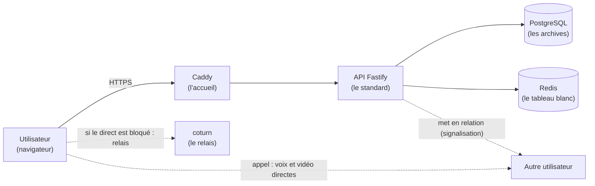

# Comprendre et expliquer l'architecture de ChatISEN

> Guide en langage simple pour comprendre chaque choix et pouvoir l'expliquer à l'oral. Il s'appuie sur [`architecture.md`](architecture.md), les [ADR](adr/) et les [rapports](reports/) : **en cas de désaccord, ces documents font foi**. Version de novembre 2026.

## Comment lire ce guide

Chaque élément a une fiche : **C'est quoi**, **Pourquoi lui**, **Ce qu'on a écarté**, **Limites** (ce qu'on répond si on nous pose la question), **Où le voir**.

Étiquettes utilisées :

- **[décidé]** : acté par l'équipe et présent dans le dépôt.
- **[proposé]** : décrit dans un ADR au statut « proposé », pas encore accepté.
- **[à confirmer]** : dépend d'une réponse du prof ou de Tom.
- **[prévu]** : annoncé, pas encore fait.

**La règle d'or de l'oral** : dire ce qu'on a décidé, ce qu'on a **mesuré**, et ce qu'on n'a **pas encore prouvé**. Le prof note la justification des choix, pas seulement l'application. Dire « on ne l'a pas encore prouvé » est une bonne réponse ; inventer un résultat ne l'est pas.

---

## 1. L'idée en une minute

ChatISEN permet de **s'écrire** (conversations privées et de groupe), de **s'appeler** (voix et vidéo à deux) et de **retrouver l'historique**. Imagine un immeuble de bureaux :

| Dans l'immeuble | Dans ChatISEN | Ce qu'il fait |
| --- | --- | --- |
| Le téléphone ou le guichet du visiteur | Le **navigateur** (client Preact) | L'écran de l'utilisateur |
| L'accueil, seule porte d'entrée | **Caddy** | Reçoit tout le monde, vérifie que le site est bien le nôtre (HTTPS), oriente chaque demande |
| Le standard et le secrétariat | L'**API Fastify** | Reçoit les demandes, vérifie qui vous êtes et ce que vous avez le droit de faire |
| La ligne interne toujours ouverte | **Socket.IO** | Livre les messages tout de suite, sans rafraîchir la page |
| Les archives | **PostgreSQL** | Garde les comptes, les conversations et les messages pour toujours |
| Le tableau blanc du bureau | **Redis** | Notes temporaires partagées ; si on l'efface, rien d'essentiel n'est perdu |
| L'appel direct entre deux collègues | **WebRTC** | La voix et la vidéo passent directement d'un navigateur à l'autre |
| Le standardiste de secours | **coturn** (STUN/TURN) | Relaie l'appel quand la ligne directe est bloquée |
| Les caméras et le journal de bord | **Prometheus, Loki, Grafana** | Montrent l'état du système et gardent la trace de ce qui s'est passé |
| Des valises standard | **Docker et Compose** | Tout est emballé de la même façon chez nous et sur le serveur |
| Le local loué | La **VM Google Cloud** | L'ordinateur sur lequel tout tourne |
| L'adresse postale fixe | L'**IP statique** et le nom `dc-ops.isen.fedyna.fr` | Là où on nous trouve |
| Les portes verrouillées | Le **pare-feu** | Seules quelques portes sont ouvertes |

Trait plein : passe par notre serveur. Pointillé : l'appel lui-même, qui ne passe **pas** par notre serveur sauf si le relais est nécessaire.

---

## 2. Cinq idées qui expliquent presque tous les choix

1. **Le serveur ne transporte jamais la voix ni la vidéo.** Il gère les comptes, les messages et la mise en relation. La voix et la vidéo circulent directement entre navigateurs. Conséquence : peu de bande passante à payer, et une confidentialité meilleure.
2. **La base de données est la seule source de vérité.** Redis, les salles de conversation et l'écran de l'utilisateur peuvent se tromper ou être perdus : on revient toujours à la base.
3. **Le serveur ne fait jamais confiance au navigateur.** Chaque demande est revérifiée côté serveur : qui es-tu, as-tu le droit de lire cette conversation ? Un navigateur peut être modifié par n'importe qui.
4. **Simple d'abord, mesuré ensuite.** Un seul serveur, Docker Compose, pas de Kubernetes. On sait que ça limite la disponibilité, et on le mesure plutôt que de l'ignorer.
5. **Une décision = un ADR.** Chaque choix structurant est écrit, justifié, relu par quelqu'un d'un autre domaine. C'est ce que le prof note.

---

## 3. Les éléments un par un

### 3.1 Le client : Preact, TypeScript et Vite **[décidé]**

- **C'est quoi** : l'application qui s'affiche dans le navigateur (connexion, conversations, appels). *Preact* sert à construire l'écran avec des briques réutilisables. *TypeScript* est du JavaScript où les erreurs de type sont trouvées avant l'exécution. *Vite* prépare l'application pour le navigateur.
- **Pourquoi lui** : Preact fait la même chose que React pour notre usage, en beaucoup plus léger, donc la page se charge plus vite. **Le poids a été mesuré** (`docs/reports/bundle-preact-vs-react.md`). TypeScript nous permet de partager les mêmes « contrats » que le serveur.
- **Ce qu'on a écarté** : React (plus lourd) et Svelte (étudié comme alternative).
- **Limites** : l'écosystème est plus petit que celui de React.
- **Où le voir** : `apps/web`, [ADR-0002](adr/0002-client-preact-vite.md), [design system](DESIGN_SYSTEM.md).

### 3.2 Le serveur : Node, TypeScript et Fastify **[décidé]**

- **C'est quoi** : le programme qui reçoit les demandes du client (inscription, envoi de message, historique), vérifie les droits et parle à la base.
- **Pourquoi lui** : Fastify vérifie automatiquement que chaque donnée reçue a la bonne forme, renvoie toujours les erreurs dans le même format, écrit des journaux faciles à relier à une requête, et se teste sans lancer de vrai serveur. C'est le même langage que le client : on partage le code des contrats.
- **Ce qu'on a écarté** : Express et NestJS, comparés selon les mêmes critères (voir l'ADR-0003).
- **Limites** : une instance gère un nombre limité de connexions. Comme le serveur ne garde aucun état, on peut le dupliquer.
- **Où le voir** : `apps/api`, [ADR-0003](adr/0003-serveur-fastify.md).

### 3.3 Les contrats partagés : TypeBox **[proposé]**

- **C'est quoi** : un dossier (`packages/shared`) qui décrit **une seule fois** la forme de chaque message échangé entre le client et le serveur. C'est comme un formulaire officiel que les deux côtés doivent respecter.
- **Pourquoi lui** : la même description sert à trois choses : les types, la vérification côté serveur, la vérification côté navigateur. Si on modifie un contrat, le projet ne compile plus des deux côtés : impossible d'oublier de mettre l'autre à jour (maintenabilité).
- **Ce qu'on a écarté** : Zod, très proche, mais TypeBox est natif dans Fastify.
- **Règle** : le client et le serveur ne dépendent jamais l'un de l'autre, seulement de ce dossier commun.
- **Où le voir** : `packages/shared`, [ADR-0005](adr/0005-contrats-typebox.md).

### 3.4 Le temps réel : Socket.IO **[proposé]**

- **C'est quoi** : une ligne ouverte en permanence entre le navigateur et le serveur, pour que les messages arrivent immédiatement. Elle sert aussi à mettre deux personnes en relation pour un appel.
- **Pourquoi lui** : elle gère toute seule la **reconnexion** après une coupure, les **salles** (une par conversation) et les **accusés de réception** (« le serveur a bien reçu »). Avec Redis, plusieurs copies du serveur peuvent se partager la diffusion.
- **Ce qu'on a écarté** : le WebSocket « brut » (il faudrait réécrire reconnexion, salles et accusés) et SSE (le serveur parle, mais le client ne peut pas répondre sur le même canal).
- **Règles importantes** : le client **ne choisit jamais** les salles qu'il écoute, c'est le serveur qui l'inscrit d'après la base. Chaque action revérifie les droits.
- **Limites** : si on lance plusieurs copies du serveur, il faut décider entre « affinité de session » et « WebSocket seul » (ADR-0011, encore ouvert).
- **Où le voir** : `apps/api/src/realtime`, [ADR-0004](adr/0004-socketio-temps-reel.md).

### 3.5 La base de données : PostgreSQL et Kysely **[proposé]**

- **C'est quoi** : les archives durables : comptes, conversations, messages, appels. *Kysely* est l'outil qui écrit les requêtes de façon vérifiée. Les *migrations* sont l'historique daté de toutes les modifications de la structure de la base, appliquées automatiquement au démarrage.
- **Pourquoi lui** : c'est une base **relationnelle** : elle garantit qu'un message appartient forcément à une conversation et à un expéditeur qui existent. Elle sait faire des **transactions** (tout ou rien), indispensables pour numéroter les messages sans erreur, et retrouver l'historique très vite grâce à un index.
- **Ce qu'on a écarté** : Drizzle, un autre outil d'accès aux données.
- **Limites** : un seul point de stockage. Les sauvegardes sont faites toutes les 6 heures. L'ordre des messages d'une même conversation passe par un compteur, ce qui peut devenir un goulot : à **mesurer**.
- **Où le voir** : `apps/api/src/db`, [ADR-0006](adr/0006-donnees-postgresql-redis-kysely.md).

### 3.6 Redis **[proposé]**

- **C'est quoi** : un tableau blanc très rapide. Il sert à diffuser les événements entre plusieurs copies du serveur, à savoir qui est en ligne, et à compter les tentatives pour limiter les abus.
- **Pourquoi lui** : ces informations changent sans cesse et n'ont pas besoin d'être gardées. C'est ce pour quoi Redis est fait, et c'est l'outil standard de Socket.IO pour plusieurs instances.
- **Limites** : **rien de durable n'y est stocké**. S'il tombe, la diffusion entre instances s'arrête, mais avec une seule instance la messagerie continue.
- **Où le voir** : [ADR-0006](adr/0006-donnees-postgresql-redis-kysely.md), `architecture.md` § 10.2.

### 3.7 Les mots de passe et les sessions **[proposé]**

- **C'est quoi** : on ne stocke jamais un mot de passe, seulement son **empreinte** (Argon2id, un algorithme conçu pour être lent à casser). Après la connexion, l'utilisateur reçoit deux « badges » : un **jeton d'accès** valable 15 minutes, gardé en mémoire, et un **jeton de renouvellement**, à usage unique, caché dans un cookie protégé que le JavaScript ne peut pas lire.
- **Pourquoi ainsi** : un jeton volé ne sert que 15 minutes. Chaque renouvellement remplace l'ancien jeton. **Si quelqu'un présente un ancien jeton déjà utilisé, on comprend qu'il a été volé et on révoque toute la famille de sessions.**
- **Limites** : une faille XSS permettrait quand même d'utiliser le jeton d'accès tant que la page est ouverte. Il n'y a pas de double authentification (hors Core).
- **Où le voir** : [ADR-0007](adr/0007-sessions-jwt-refresh-rotatif.md), `architecture.md` § 6.1.

### 3.8 L'ordre et l'unicité des messages **[proposé]**

- **C'est quoi** : chaque message reçoit un **numéro** dans sa conversation, attribué par le serveur, au moment de l'enregistrement. L'ordre affiché est ce numéro, **jamais l'heure du téléphone** (qui peut être fausse). Le client fabrique aussi un identifiant unique par message.
- **Pourquoi** : si le réseau coupe pendant un envoi, le client renvoie le message avec le **même identifiant** : le serveur reconnaît qu'il l'a déjà et ne crée pas de doublon.
- **Où le voir** : [ADR-0008](adr/0008-ordre-idempotence-messages.md).

### 3.9 Les appels : WebRTC, STUN et TURN (coturn) **[proposé]**

- **C'est quoi** : *WebRTC* est la technologie des navigateurs pour la voix et la vidéo **directement** entre deux personnes. Le serveur ne sert qu'à les **mettre en relation** : c'est la « signalisation », un échange de cartes de visite techniques passé par Socket.IO. *STUN* répond à la question « quelle est mon adresse vue d'Internet ? ». *TURN* est un **relais de secours** quand la connexion directe est impossible (box ou réseau d'école trop stricts).
- **Pourquoi ainsi** : pas de bande passante à payer pour la voix ni la vidéo, plus simple, et plus confidentiel : le flux est chiffré (DTLS-SRTP) et **même le relais n'en voit pas le contenu**.
- **Identifiants TURN temporaires** : le serveur calcule, à partir d'un secret qu'il partage avec coturn, un identifiant valable peu de temps. Aucun mot de passe permanent n'est donné au navigateur, ce qui empêche d'utiliser notre relais gratuitement.
- **Ce qu'on a écarté** : un serveur qui relaierait lui-même la vidéo. Pour les **conférences**, deux options existent : le *mesh* (chacun envoie à chacun, ça explose au-delà de 3 ou 4 participants) et le *SFU* (un serveur redistribue, plus complexe). Les conférences sont **suspendues** pour le 11 décembre.
- **Limites** : le relais voit des métadonnées (adresses, volume), pas le contenu. Les messages TURN eux-mêmes ne sont pas chiffrés (pas de TLS sur le port 5349). Il n'y a **pas de TURN sur le port 443** : un réseau qui ne laisse passer que le 443 bloquera les appels relayés. C'est le **risque R4**, à mesurer depuis le réseau de la salle de démo.
- **Où le voir** : [ADR-0009](adr/0009-webrtc-p2p-coturn.md), [ADR-0016](adr/0016-point-d-entree-caddy-et-ports-turn.md), `architecture.md` § 6.4.

### 3.10 Le point d'entrée : Caddy **[proposé]**

- **C'est quoi** : l'accueil de l'immeuble. C'est la seule porte web publique. Il chiffre les échanges (HTTPS) avec un certificat qu'il obtient et renouvelle tout seul, sert l'application du client, et transmet `/api` et `/socket.io` au serveur.
- **Pourquoi un seul nom** (`dc-ops.isen.fedyna.fr`) : une seule demande au prof (il crée les noms un par un, sans joker), un seul certificat, et le client et l'API sont sur la **même origine** : les cookies stricts fonctionnent et il n'y a pas de réglage de CORS à faire.
- **Ce qu'on a écarté** : Traefik (plus lourd pour trois routes), Nginx avec certbot (deux outils à synchroniser), et un sous-domaine par service (quatre demandes au prof).
- **Choix de détail** : HTTP/3 est coupé, parce qu'il utiliserait un port UDP que le pare-feu n'ouvre pas.
- **Limites** : les protections de base sont en place (HSTS, `nosniff`, `Referrer-Policy`), mais la politique **CSP** n'est **pas encore** écrite. Derrière un proxy, le serveur voit l'adresse de Caddy au lieu de celle du client, tant que le réglage `TRUST_PROXY` n'est pas activé : sinon la limitation de débit traiterait tout le monde comme un seul utilisateur.
- **Où le voir** : `infra/caddy/Caddyfile`, [ADR-0016](adr/0016-point-d-entree-caddy-et-ports-turn.md).

### 3.11 Docker et Docker Compose **[proposé]**

- **C'est quoi** : Docker emballe chaque service avec tout ce dont il a besoin (comme une valise). Compose est un fichier qui décrit toutes les valises et les lance ensemble.
- **Pourquoi** : les mêmes images servent en développement et sur le serveur : c'est **reproductible**. Une seule commande démarre tout.
- **Ce qu'on a écarté** : Kubernetes (k3s), suspendu : trop long à mettre en place et à exploiter en 18 jours pour un besoin d'un seul serveur.
- **Limites** : un seul serveur signifie qu'il n'y a pas de haute disponibilité (voir § 7).
- **Où le voir** : `infra/compose/`, [ADR-0012](adr/0012-deploiement-et-hebergement.md).

### 3.12 La supervision : Prometheus, Loki, Grafana **[proposé]**

- **C'est quoi** : *Prometheus* relève régulièrement des chiffres (nombre de connexions, temps de réponse, erreurs). *Loki* garde le journal des événements. *Grafana* affiche des tableaux de bord et déclenche des alertes. Les journaux sont écrits en JSON par Fastify, avec un identifiant de requête qui permet de suivre un incident de bout en bout.
- **Pourquoi** : le sujet demande de voir l'état du système, de détecter les pannes et de mesurer. C'est aussi ce qui permet de faire les **six axes d'investigation** (charge, qualité d'appel, sécurité, optimisation, données, IA).
- **Accès** : Grafana et Prometheus **ne sont pas exposés à Internet** ; on y accède par un tunnel SSH.
- **Limites** : tant qu'ils tournent sur la même VM, ils tombent avec ce qu'ils surveillent. Il n'y a pas encore d'ADR dédié à ce choix.
- **Où le voir** : `architecture.md` § 10.

### 3.13 La chaîne de livraison : GitHub Actions et ses contrôles **[décidé en grande partie]**

- **C'est quoi** : à chaque proposition de changement (pull request), des contrôles automatiques vérifient le format du titre, le lien avec une issue et une exigence, la qualité du code, les tests et l'analyse de sécurité (Semgrep). La branche principale est **protégée** : pas de modification directe, au moins une approbation d'une autre personne, pas de réécriture de l'historique. Les actions GitHub sont épinglées par leur empreinte et les dépendances attendent 7 jours avant d'être adoptées, pour éviter les paquets malveillants publiés trop récemment. Les versions et le journal des changements sont générés automatiquement (release-please).
- **Prévu** : construction des images, analyse Trivy, publication dans un registre et déploiement sur la VM (issue #12). **Ce n'est pas encore en place.**
- **Pourquoi** : le projet est noté sur le DevOps. Ce qui est automatisé est reproductible, traçable et ne dépend pas de la mémoire de quelqu'un.
- **Où le voir** : `.github/workflows/`, `infra/github/`, [ADR-0014](adr/0014-release-please.md), `CONTRIBUTING.md`.

### 3.14 L'hébergement : Google Cloud **[proposé]**

- **C'est quoi** : une VM Compute Engine, c'est-à-dire un ordinateur loué (Debian 12, 2 processeurs, 8 Go de mémoire), en Belgique, avec une **IP statique** réservée, un pare-feu, et un accès administrateur par compte Google (OS Login) sans mot de passe à retenir.
- **Pourquoi Google Cloud** : compte et VM prêts en quelques minutes, 269 € de crédit d'essai jusqu'au 22 février 2027, donc au-delà de la soutenance. Oracle avait été la première piste mais l'inscription est restée bloquée.
- **Ce qu'on a écarté** : Oracle (inscription bloquée), la machine d'un membre (IP qui change, ports UDP fermés, disponibilité aléatoire), une VM de l'école (non proposée). Un VPS loué reste le plan B.
- **Limites** : un seul hôte, donc un point unique de défaillance **assumé**. Un arrêt automatique à minuit a été configuré pour économiser le crédit (son bon fonctionnement reste à vérifier) ; la nuit, il n'y a alors ni sauvegarde ni mesure.
- **Où le voir** : [ADR-0012](adr/0012-deploiement-et-hebergement.md), [`infra/README.md`](../infra/README.md).

### 3.15 Le pare-feu et l'accès administrateur **[décidé, avec une faiblesse connue]**

Le pare-feu fonctionne comme des portes verrouillées : **tout est fermé, sauf ce qu'on ouvre exprès**.

| Porte | Ouverte à | Pourquoi |
| --- | --- | --- |
| 80 et 443 (TCP) | tout Internet | Le site web (80 sert à la redirection et à la validation du certificat) |
| 3478 (TCP et UDP) | tout Internet | Demandes de relais TURN |
| 49152 à 49252 (UDP) | tout Internet | Voix et vidéo relayées |
| 5349 (TCP) | tout Internet | **Ouverte sans service : à fermer** |
| 22 (TCP) | **tout Internet** | Administration par SSH : **faiblesse connue**, à remplacer par un accès par IAP |
| ICMP et trafic interne | Internet (ping), réseau privé | Diagnostic, communication entre machines du réseau |
| 5432, 6379, 3000, 9090 | **personne** | PostgreSQL, Redis, API, Prometheus : jamais exposés |
| 3389 (RDP) | supprimée le 25 novembre | Inutile |

**Pourquoi fermer** : chaque porte ouverte est une porte à surveiller. **IAP** est un tunnel de Google qui vérifie votre compte avant de laisser passer le SSH : on n'a plus besoin d'ouvrir le 22 à tout le monde. Cela règle aussi le cas de GitHub, dont les adresses changent et ne peuvent pas être listées.

### 3.16 Les sauvegardes **[décidé, dans le code]**

- **C'est quoi** : toutes les 6 heures, un export de la base est chiffré avec une **clé publique**, puis conservé 7 jours. La **clé privée n'est jamais sur le serveur** : même si le serveur est piraté, les sauvegardes restent illisibles. La restauration est **testée automatiquement** chaque semaine.
- **Pourquoi** : perdre les données serait le pire scénario. Une perte maximale de 6 heures est le compromis assumé.
- **Limite principale** : il n'y a pas encore de **copie hors de la VM** (issue #42). Si la VM disparaît, les sauvegardes disparaissent avec elle.
- **Où le voir** : `infra/backup/`, `docs/reports/backup-restore-test.md`.

### 3.17 Ce qui reste à confirmer

Quatre sujets sont décrits dans la vue **cible** de [`architecture.md`](architecture.md) § 8.3. Ils ne sont **pas** à présenter comme acquis.

| Sujet | Pour | Contre ou inconnue | État |
| --- | --- | --- | --- |
| **Terraform** : décrire l'infrastructure dans des fichiers au lieu de clics | Relu en pull request, rejouable, on voit ce qui change avant de l'appliquer | Un fichier d'état sensible à protéger, ressources existantes à importer | **[proposé]**, [ADR-0018](adr/0018-terraform-et-load-balancer-gcp.md) |
| **Load balancer GCP** : une porte d'entrée unique devant le web et TURN, avec la même IP | Une seule IP, sondes de santé | Facturé à l'heure **même VM éteintes** (environ 0,025 $ par heure d'après la page de tarifs, à confirmer) plus 0,008 $ par Gio ; pas de forfait mensuel ; coturn derrière un load balancer reste à tester | Retenu par l'équipe, **à valider par la mesure** |
| **VM TURN séparée** | Le prof : coturn consomme beaucoup et peut geler Caddy ; mieux pour la montée en charge | Une VM de plus à créer, durcir, payer ; contredit l'ADR-0016 | **[à confirmer]** (prof, Tom) |
| **Base chez Supabase** | Le prof : la base ne doit pas être sur la VM ; les données survivent à la perte de la VM | Contredit l'ADR-0006 ; un aller-retour Internet à chaque requête ; limites de l'offre gratuite non vérifiées ; sauvegardes à revalider ; risqué à deux jours du jalon J1 | **[à confirmer]** |

Pour J1, la base reste dans le Compose, et coturn sur la même VM que le reste.

---

## 4. Les données : entités et relations

Une base relationnelle, ce sont des **classeurs** (les tables) dont les fiches se renvoient les unes aux autres. Voici chaque classeur, et pourquoi il existe.

| Entité | C'est quoi | Pourquoi ce choix |
| --- | --- | --- |
| **USERS** | Un compte : identifiant, e-mail, nom affiché, empreinte du mot de passe | Le mot de passe n'est jamais stocké. Les identifiants ne tiennent pas compte des majuscules : « Sha » et « sha » sont le même compte. |
| **SESSIONS** | Une connexion depuis un appareil | On y garde l'**empreinte** du jeton de renouvellement, pas le jeton lui-même. Un numéro de « famille » regroupe les renouvellements successifs pour repérer un jeton volé. |
| **CONVERSATIONS** | Une discussion, privée (deux personnes) ou de groupe, avec un compteur du dernier numéro de message | Le compteur est à l'origine de l'ordre des messages. |
| **CONVERSATION_MEMBERS** | Qui est dans quelle conversation, avec quel rôle (propriétaire, administrateur, membre) et jusqu'où il a lu | **C'est cette table qui décide qui a le droit de voir quoi.** Savoir jusqu'où chacun a lu suffit à calculer les messages non lus, sans table supplémentaire. |
| **MESSAGES** | Un message : conversation, expéditeur, numéro dans la conversation, identifiant unique fabriqué par le client, texte, date | Le numéro donne l'ordre. L'identifiant évite les doublons au renvoi. Un index sur (conversation, numéro) rend l'historique rapide. |
| **CALLS** | Un appel : voix ou vidéo, qui l'a lancé, début, fin, raison de la fin | Garde la trace des appels. |
| **CALL_PARTICIPANTS** | Qui était réellement dans l'appel | Être membre de la conversation ne suffit pas pour envoyer des mesures de qualité sur un appel. On garde la ligne après le départ, pour conserver l'historique. |
| **CALL_QUALITY_SAMPLES** | Relevés de qualité toutes les 5 secondes : délai, instabilité (jitter), perte, débit, type de chemin (direct ou relais) | Alimente le travail sur les données et l'IA. Le serveur déduit l'identité du jeton de connexion, jamais du contenu envoyé, et limite les envois. |

Les tables d'appels sont décrites dans l'architecture ; leur implémentation arrive avec les appels (PR en cours).

**Les relations, en phrases :**

- Un **utilisateur** a plusieurs **sessions** (un appareil = une session).
- Un utilisateur est **membre** de plusieurs conversations, et une conversation a plusieurs membres : la table des membres relie les deux.
- Une conversation **contient** des messages ; un utilisateur en **envoie**.
- Une conversation **héberge** des appels ; un appel **réunit** des participants ; chaque participant **produit** des relevés de qualité.
- Une conversation privée a **exactement deux** membres.

---

## 5. Les flux, racontés

### 5.1 Se connecter

1. L'utilisateur envoie son identifiant et son mot de passe à l'API.
2. L'API compare avec l'empreinte en base. Elle met le **même temps** à répondre même si le compte n'existe pas, pour ne pas révéler quels comptes existent.
3. Elle renvoie un jeton d'accès (15 minutes) et pose le jeton de renouvellement dans un cookie protégé.
4. Le navigateur ouvre la ligne Socket.IO en présentant son jeton ; le serveur l'inscrit lui-même dans les bonnes salles, d'après la base.
5. Quand le jeton expire, le navigateur le renouvelle ; l'ancien jeton est révoqué.

**Pourquoi** : voir § 3.7. Un vol de jeton est limité dans le temps et détectable.

### 5.2 Envoyer un message

1. L'expéditeur voit son message **tout de suite** avec la mention « envoi… ».
2. Le serveur vérifie que l'expéditeur est bien membre, puis, dans une seule transaction, numérote et enregistre le message.
3. Il répond « bien reçu » avec le numéro. L'écran confirme.
4. Il diffuse aux autres membres, y compris sur d'autres copies du serveur grâce à Redis.

**Pourquoi** : l'écran réagit instantanément, mais la confirmation vient du serveur. Si le « bien reçu » n'arrive pas, le client renvoie avec le même identifiant : pas de doublon.

### 5.3 La coupure réseau

1. Socket.IO détecte la coupure et retente de se connecter de plus en plus lentement.
2. Pour chaque conversation ouverte, le client sait quel est le dernier numéro de message reçu.
3. À la reconnexion, il demande « donne-moi tout ce qui suit ce numéro » et reçoit les messages manqués, dans l'ordre.
4. Les messages restés en « envoi… » sont renvoyés avec leur identifiant d'origine.

**Pourquoi** : la base est la source de vérité, donc le rattrapage marche même si on retombe sur une autre copie du serveur. Un test de bout en bout couvre ce scénario (`docs/reports/e2e-messagerie.md`).

### 5.4 Retirer quelqu'un d'une conversation

1. Le retrait est enregistré en base.
2. Seulement ensuite, le serveur sort les connexions de la personne retirée de la salle de la conversation, sur **toutes** les copies du serveur.
3. La personne est prévenue, les autres membres aussi.
4. Chaque action ultérieure revérifie quand même l'appartenance en base.

**Pourquoi** : sans cela, quelqu'un retiré continuerait à recevoir les messages jusqu'à sa reconnexion, ce qui serait une fuite d'accès à une conversation privée. Si Redis perdait l'ordre de retrait, l'exposition serait au pire de **15 minutes** (la durée du jeton), à signaler dans le rapport de sécurité.

### 5.5 Un appel voix ou vidéo à deux

1. L'appelant demande au serveur des identifiants TURN temporaires, puis lance l'appel.
2. Le serveur prévient l'autre personne (sonnerie) ; elle accepte.
3. Les deux navigateurs s'échangent, par le serveur, leurs « cartes de visite » techniques. Le serveur n'accepte ces échanges que des **deux participants autorisés**.
4. Ils essaient de se connecter **directement**. Si c'est impossible, ils passent par le relais coturn.
5. La voix et la vidéo circulent, chiffrées. Toutes les 5 secondes, chaque navigateur mesure la qualité (délai, perte, instabilité) et l'envoie par lots.

**Si le serveur tombe pendant l'appel**, l'appel continue (le média ne passe pas par lui) : on ne peut juste plus renégocier.

### 5.6 Les flux réseau, de F00 à F21

Le détail (ports, preuves, fichiers) est dans le tableau de [`architecture.md`](architecture.md) § 8.3. Voici le sens de chacun.

**Entre Internet et la VM**

| N° | Ce que c'est | Chiffré ? | Pourquoi ainsi |
| --- | --- | --- | --- |
| F00 | Le navigateur demande l'adresse du nom au DNS | **Non** (DNS classique) | Inévitable : c'est le fonctionnement normal d'Internet |
| F01 | Le site en HTTPS et la ligne Socket.IO sécurisée, port 443 | Oui, TLS terminé par Caddy | La confidentialité des échanges |
| F02 | HTTP sur le port 80 | Non | Sert seulement à rediriger vers HTTPS |
| F03 | L'autorité de certification vérifie que le site est bien à nous, par le port 80 | Non (défi public) | Condition pour obtenir le certificat. L'émetteur (Let's Encrypt ou ZeroSSL) n'a pas été relevé |
| F04 | Demande de relais à coturn, port 3478 | **Non** (pas de TLS) | Choix assumé de la première version : plus simple ; ne contient pas la voix |
| F05 | La voix et la vidéo relayées, ports UDP 49152 à 49252 | Oui, DTLS-SRTP | Le relais ne voit pas le contenu |
| F06 | Port 5349 (TURN sur TLS) | — | Ouvert sans service, à fermer |
| F07 | SSH vers la VM, port 22 | Oui, SSH | Administration. **Ouvert à tout Internet : faiblesse connue** |
| F08 | SSH par le tunnel IAP | Oui | Remplace F07 |
| F09 | Déploiement depuis GitHub | Oui (SSH ou HTTPS) | À trancher : par IAP, ou la VM va chercher elle-même |
| F10 | Sondes de santé de Google (vue cible) | Non | Le load balancer vérifie que les serveurs répondent |

**Entre nos services et vers l'extérieur**

| N° | Ce que c'est | Chiffré ? | Pourquoi ainsi |
| --- | --- | --- | --- |
| F11 | Caddy vers l'API | **Non** (HTTP simple) | Même machine, réseau Docker privé. Limite : si l'intérieur est compromis, le trafic est lisible |
| F12 | L'API vers Redis | **Non** | Idem |
| F13 | L'API vers PostgreSQL | **Non** en J1 (même machine) ; **TLS** vers Supabase en cible | Réseau privé en J1 ; Internet en cible |
| F14 | La sauvegarde lit PostgreSQL | Fichier chiffré (age) | Un fichier volé est inutilisable |
| F15 | Tunnel SSH vers Grafana | Oui | Grafana n'est jamais exposé à Internet |
| F16 | Prometheus lit les métriques de coturn (vue cible) | Non | Réseau privé de la VM |
| F17 | L'API et coturn partagent un secret | **Aucun flux réseau** | Le secret est configuré des deux côtés, jamais transmis |
| F18 | Les VM sortent sur Internet (registre, certificats, Supabase) | Oui (HTTPS) | Besoin de télécharger et de valider |
| F19 et F20 | La CI envoie les images au registre ; la VM les récupère | Oui | Chaîne de livraison, registre **pas encore choisi** |
| F21 | Copie des sauvegardes hors de la VM | Oui | **Manquante** (issue #42) |

---

## 6. La sécurité en clair

**Ce qui est chiffré**

- Le site et la messagerie en transit : HTTPS, WSS.
- La voix et la vidéo : DTLS-SRTP, même quand elles passent par le relais.
- L'administration : SSH.
- Les sauvegardes : chiffrées avec une clé publique, clé privée hors du serveur.
- Le disque de la VM : chiffré par Google par défaut, d'après le fonctionnement standard du fournisseur ; **nous ne l'avons pas vérifié dans notre configuration**.

**Ce qui n'est pas chiffré, et pourquoi on l'assume**

- Le trafic **entre les conteneurs** d'une même VM (F11, F12, F13 en J1) : réseau privé, même machine.
- Les messages **TURN** (pas de TLS) : la voix reste chiffrée.
- **Les messages en base** : le serveur peut les lire. Pas de chiffrement de bout en bout, car la recherche et l'historique côté serveur en dépendent. C'est un choix à **énoncer dans le rapport**, pas à cacher.

**Menace → protection → limite**

| Menace | Protection | Limite assumée |
| --- | --- | --- |
| Quelqu'un écoute le réseau | HTTPS, WSS, média chiffré | Le relais TURN voit les métadonnées |
| Vol de mot de passe | Empreinte Argon2id, limitation des tentatives | Pas de double authentification |
| Vol de session | Jeton court, renouvellement à usage unique, détection de réutilisation | Une faille XSS peut utiliser le jeton tant que la page est ouverte |
| Lire la conversation d'un autre | Vérification **côté serveur** à chaque demande et à chaque événement ; salles choisies par le serveur | Si Redis perd un ordre de retrait : 15 minutes au pire |
| Données malformées ou malveillantes | Chaque donnée est vérifiée contre son schéma ; requêtes paramétrées | — |
| Script injecté dans un message | Preact échappe tout par défaut | La politique CSP reste à écrire |
| Abus du relais TURN | Identifiants temporaires ; plages d'adresses privées interdites | — |
| Données volées sur le serveur | Sauvegardes chiffrées, clé privée absente | Pas de copie hors de la VM |
| Code ou dépendance piégés | Analyse Semgrep, dépendances retardées de 7 jours, actions épinglées, contrôle des images (prévu) | — |

---

## 7. Pannes, fiabilité et montée en charge

| Si ça tombe… | Ce qui se passe | Ce qui nous protège |
| --- | --- | --- |
| Une copie de l'API | Ses clients sont déconnectés | Reconnexion automatique sur une autre copie, puis rattrapage par numéro de message |
| Redis | Plus de diffusion entre copies, plus de présence | Avec une seule copie, la messagerie continue ; Redis ne contient rien de durable |
| PostgreSQL | Plus d'envoi ni d'historique | L'état de santé passe en échec, le client affiche une erreur claire et garde les messages en attente ; restauration depuis la sauvegarde (6 heures de perte au pire) |
| coturn | Les appels derrière un réseau strict échouent ; le direct fonctionne encore | Alerte dédiée, message d'erreur explicite |
| Toute la VM | Tout est indisponible | **Assumé** : un seul hôte. La disponibilité est traitée par la **mesure** (panne volontaire, redémarrage, restauration), pas par la redondance |

**La montée en charge** : le serveur ne garde aucun état, donc on peut en lancer plusieurs. Les goulots probables sont à **vérifier par la mesure** : le compteur de messages par conversation, le nombre de connexions par instance, la bande passante TURN. Le test de **point de rupture** (jusqu'où une seule instance tient) est prévu avec k6 (issue #24).

---

## 8. Ce qui est prouvé, ce qui ne l'est pas

**Prouvé ou mesuré**

- Le nom de domaine pointe vers la VM, le HTTPS répond sur le port 443 et le certificat est reconnu sans exception (`docs/reports/ports-tls-2026-11-25.md`).
- Le poids du client Preact comparé à React (`docs/reports/bundle-preact-vs-react.md`).
- La restauration d'une sauvegarde (`docs/reports/backup-restore-test.md`).
- Plusieurs scénarios de messagerie de bout en bout, dont la coupure réseau (`docs/reports/e2e-messagerie.md`).

**Pas encore prouvé**

- Que les ports qui doivent être fermés le sont, depuis un réseau adapté, et le port 80 (issue #112).
- L'émetteur du certificat.
- La restriction du SSH par IAP.
- Un appel relayé par TURN, et le comportement depuis le réseau de la salle de démo.
- La charge, le point de rupture et l'optimisation (issues #24 et #26).
- Le coût réel du load balancer et coturn derrière un load balancer.
- Le déploiement complet (Dockerfiles, Compose de déploiement, workflow) : issue #12.
- Tout ce qui dépend de Supabase et de la VM TURN séparée.

---

## 9. Questions probables du prof

**Pourquoi Preact et pas React ?** Parce que, pour notre usage, il fait la même chose en beaucoup plus léger, et on l'a mesuré. La limite : un écosystème plus petit.

**Pourquoi Socket.IO et pas le WebSocket de base ?** Il gère déjà la reconnexion, les salles et les accusés de réception, que nous aurions dû réécrire. La question des plusieurs copies du serveur (affinité de session) est encore ouverte.

**Pourquoi PostgreSQL et Redis ?** PostgreSQL garantit la cohérence et les transactions pour tout ce qui doit durer. Redis sert pour ce qui est rapide et jetable. Rien d'essentiel n'est stocké dans Redis.

**Pourquoi le serveur ne relaie-t-il pas la vidéo ?** Pour ne pas payer ni saturer la bande passante, et parce que le flux reste chiffré de bout en bout entre les deux personnes. Un relais (TURN) n'intervient que si le direct est impossible, et il ne voit pas le contenu.

**À quoi sert TURN, et pourquoi pas sur le port 443 ?** TURN relaie l'appel quand la connexion directe est bloquée. Le 443 est pris par Caddy. Le risque est qu'un réseau qui ne laisse passer que le 443 bloque les appels relayés : on le mesure depuis la salle de démo.

**Comment protégez-vous une conversation privée ?** Le serveur vérifie l'appartenance en base à chaque demande et à chaque événement. Le client ne choisit jamais ses salles. Quand quelqu'un est retiré, il sort des salles tout de suite sur toutes les copies du serveur.

**Qu'est-ce qui n'est pas chiffré ?** Le trafic entre nos conteneurs sur la même machine, les messages TURN, et le contenu des messages en base, que le serveur peut lire. C'est un choix assumé, à énoncer dans le rapport.

**Pourquoi un seul nom de domaine ?** Une seule demande au prof, un seul certificat, et le client et l'API partagent la même origine : les cookies stricts marchent et il n'y a pas de CORS.

**Pourquoi Compose et pas Kubernetes ?** Parce qu'un seul serveur ne justifie pas la complexité, et qu'on a 18 jours. On a une limite assumée : pas de haute disponibilité.

**Pourquoi Google Cloud ?** Compte et VM en quelques minutes, un crédit qui couvre le projet, et l'inscription Oracle était bloquée.

**Que se passe-t-il si la VM tombe ?** Tout est indisponible : c'est assumé. On le traite par la mesure (panne volontaire, redémarrage, restauration), pas par de la redondance. Le plan B est un serveur loué.

**Pourquoi Terraform, et combien coûte le load balancer ?** Terraform rend l'infrastructure relue et rejouable. Le load balancer est facturé à l'heure, même VM éteintes, environ 0,60 $ par jour d'après la page de tarifs, à confirmer. Le levier est la durée, pas le volume. C'est encore à valider.

**Qu'est-ce qui est prouvé ?** Voir § 8. Ne jamais présenter comme acquis ce qui est « à confirmer » ou « pas encore prouvé ».

---

## 10. Glossaire

- **API** : le programme serveur auquel le client envoie ses demandes.
- **Argon2id** : algorithme qui transforme un mot de passe en empreinte, volontairement lent à casser.
- **Cookie `httpOnly`** : un cookie que le JavaScript de la page ne peut pas lire.
- **CORS** : règle des navigateurs qui contrôle les appels entre sites différents ; inutile quand client et API ont la même origine.
- **DNS** : l'annuaire qui relie un nom (`dc-ops…`) à une adresse IP.
- **DTLS-SRTP** : le chiffrement des flux voix et vidéo de WebRTC.
- **Docker, Compose** : emballage des services dans des « valises » et fichier qui les lance ensemble.
- **HTTPS, TLS** : le chiffrement des échanges web.
- **IAP** : tunnel de Google qui vérifie le compte avant de laisser passer le SSH.
- **ICE** : la méthode que WebRTC utilise pour trouver le meilleur chemin entre deux personnes.
- **IP statique** : adresse qui ne change pas.
- **JWT** : le « badge » signé qui prouve qui vous êtes, ici valable 15 minutes.
- **Load balancer** : porte d'entrée qui répartit le trafic vers un ou plusieurs serveurs.
- **Mesh, SFU** : deux manières de faire une conférence (tout le monde envoie à tout le monde, ou un serveur redistribue).
- **NAT** : mécanisme des box qui cache les appareils derrière une seule adresse ; c'est lui qui complique les appels directs.
- **OS Login** : connexion à la VM avec un compte Google plutôt qu'avec des mots de passe.
- **Pare-feu** : l'ensemble des portes ouvertes ou fermées.
- **Pooler** : intermédiaire qui partage un petit nombre de connexions à la base entre de nombreux clients.
- **Reverse proxy** : le serveur d'accueil (ici Caddy) qui reçoit les demandes et les transmet aux bons services.
- **Signalisation** : l'échange de cartes de visite techniques qui précède un appel.
- **STUN, TURN** : STUN dit quelle est votre adresse vue d'Internet ; TURN relaie l'appel quand le direct échoue.
- **Terraform** : outil qui décrit l'infrastructure dans des fichiers au lieu de clics.
- **VPC** : le réseau privé virtuel de notre projet Google Cloud.
- **WebRTC** : technologie des navigateurs pour la voix et la vidéo en direct.
